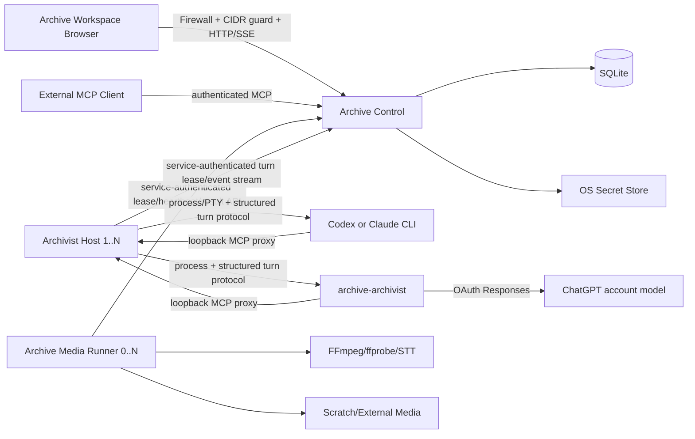

# 02. 실행 컨테이너와 컴포넌트 경계

## 1. 컨테이너 관계



## 2. Archive Control

Archive Control만 운영 DB에 직접 쓴다.

| 컴포넌트 | 책임 |
|---|---|
| HTTP Adapter | 인증, 요청 DTO, 오류 매핑, Notification SSE 연결 |
| MCP Adapter | 업무 의미 도구와 async task handle 제공 |
| Command Bus | envelope·권한·리비전 검사, idempotency, 상태·CommandRecord·Event·receipt Unit of Work |
| Workflow Engine | DAG, StepState, 재시도, Approval, ExecutionLease·fencing |
| Resource Scheduler | Worker metric과 정책으로 실행 허용 판단 |
| Dispatch Coordinator | 영속 ready queue 순서, aging·Job 공정성, Worker 선택과 ResourceReservation·lease 원자 확정 |
| Archivist Gateway | Session·Turn context와 Tool Call 상관관계; 다계정 Provider routing·폴백은 planned |
| Archive Workspace Service | 사람 직접 Command, ArchivistSession·ArchivistTurn, 공통 작업 문맥과 ActionCard 조립 |
| Archivist Session Service | ArchivistSession·ArchivistTurn·lease·fencing·ActionCard 원장 |
| Repository Adapter | SQLite transaction과 projection |
| Sidecar Service | archive export/import |

각 도메인 기능은 protocol과 무관한 Application Capability Port로 먼저 제공한다. CLI, test, Scheduler, HTTP와 MCP는 같은 Capability Registry를 호출하므로 서버 Adapter가 없어도 기능 자체를 직접 실행할 수 있다. 장시간 기능은 동기 HTTP 응답을 붙잡지 않고 Job/Step ID를 반환한다. 세부 계약은 [10. 도메인 기능 실행과 검증 증적](10-capabilities-observability.md)을 따른다. `APP-001`

HTTP와 MCP는 Domain 함수를 직접 호출하지 않고 같은 Command Bus를 사용한다. Handler는 저장 상태를 직접 바꾸지 않고 새 상태와 Event를 반환하며 Store가 상태·CommandRecord·Event·receipt를 한 번에 확정한다. Core 경계는 `CMD-001~010`, 실제 SQLite transaction은 `PER-001` integration test로 검증한다.

v1 Archive Control는 strict boot YAML에서 DB·listen·CIDR·Origin·Worker·Storage topology를 읽어 시작하며 `archive-control` 실행 파일이 `internal/adapter/controlruntime` 조립 Adapter를 열어 SQLite Command Store·카탈로그, 아카이브 작업 공간 projection과 Notification SSE를 하나의 HTTP Handler에 조립한다. Application 패키지는 이 구체 Adapter 조립을 import하지 않는다. Worker와 Archivist Host credential reference는 Windows의 `wincred://`·절대 `dpapi://`와 macOS의 `keychain://`를 허용하되 raw secret·상대 DPAPI 경로는 거부한다. 정적 아카이브 작업 공간과 health, 자산·전사·요약·검수·Job 조회·명령 API는 실제 peer CIDR 검사를 공통으로 통과하고 protocol DTO에서 Storage 경로를 제외한다. 같은 boot topology의 재시작은 멱등하지만 기존 Storage ID의 물리 identity나 root 변경은 시작 오류다. 사용자는 Archivist 없이도 Job을 직접 만들 수 있고, 사람 직접 Command와 Archivist Tool Call은 같은 Command Bus를 통과한다. 상태·명령·Event·receipt가 SQLite transaction으로 확정된 다음 공통 읽기 투영을 갱신한다. `CFG-006`, `CTL-001~004`, `COL-001`

ArchivistSession·ArchivistTurn은 Control이 먼저 SQLite에 확정하고 Archivist Host가 outbound 연결로 claim한다. Host는 로컬 CLI process/PTY와 resume token만 감독하며 업무 상태나 승인 정책을 소유하지 않는다. 전체 Orca 앱은 배포 구성요소가 아니고, 최소 Embedded Core가 기본 runtime backend이며 Orca CLI 연동은 같은 Port의 선택형 Adapter다. Embedded Core는 Codex·Claude 외에도 `archive-archivist` 한 process를 실행해 ChatGPT account model과 loopback MCP 사이의 제한된 단일 Turn 루프를 제공한다. 자세한 계약은 [11. 로컬 CLI Archivist Host 설계](11-archivist-host.md)를 따른다. `LRH-001~008`, `AGT-016~020`, `CTL-005~006`

## 3. MediaOperation과 선택형 Runner

단일 파일 작업은 `archive-media` CLI가 아래 처리 경계를 Control 없이 직접 실행한다. 여러 PC의 큐·리스·자원 관측이 필요할 때만 같은 실행 파일의 `runner` 하위 명령이 Worker 역할을 맡는다. 두 실행 방식은 동일한 MediaOperation Adapter와 StorageRoot 게시 경계를 공유한다. `APP-009~010`

관리 Runner는 다음 순서로 단계 하나를 처리한다.

```text
lease claim
→ 입력 artifact와 storage reservation 확인
→ subprocess 시작
→ heartbeat/progress 전송
→ 임시 출력에 기록
→ 출력 probe/checksum/QC
→ atomic publish 요청
→ result 보고
```

Worker는 DB 파일을 직접 열지 않는다. Control API가 내려준 ID와 허용된 storage root만 사용하며, 임의의 사용자 제공 절대경로를 실행 인수로 신뢰하지 않는다.

같은 PC의 local Worker도 원격 Worker와 같은 registry·ExecutionLease 계약을 사용한다. PC를 추가할 때 Worker만 설치하고 boot config에 `worker_id`, credential reference, 처리 종류를 등록한다. 원격 Worker가 Control에 outbound 연결하므로 Worker PC에는 inbound 포트를 열지 않는다.

v1 `archive-media runner`는 별도 strict YAML의 identity·Control URL·Windows Credential Manager reference·heartbeat·claim 주기·접근 Storage를 읽고 Control로 outbound bounded heartbeat·별도 folder inventory와 Step claim·lease renewal·결과·취소 정리를 보낸다. Control의 `/worker/v1`은 아카이브 작업 공간 로그인 설정과 무관하게 매 요청의 Worker별 Bearer credential을 Resolver 값과 비교하고, 성공한 상태만 credential 없이 Archive Workspace Worker 상태 영역에 투영한다. loopback HTTP는 All-in-One 개발 구성에만 허용하고 원격 Control URL은 HTTPS만 허용한다. Resolver·HTTP 계약은 fixture 통합으로 검증하고 실제 Windows Credential Manager 호출은 격리 Windows acceptance 전까지 계획 상태다. `CFG-007`, `WRK-005~015`, `CAN-001~005`

## 4. 프로세스 장애 경계

- Worker 종료는 Archive Control와 아카이브 작업 공간을 종료하지 않는다.
- Control 재시작 후 DB의 RUNNING ExecutionLease·Worker 결과 receipt·completion outbox를 검사해 정산된 후속 처리를 재개한다. 게시됐지만 결과 receipt 전 중단된 파일 조정은 `EXE-003` planned다. `WFL-004`, `WFL-009`, `WRK-014`
- subprocess 결과는 임시 경로에 쓰고 검증 전 Artifact로 게시하지 않는다. `EXE-001~002`
- Worker는 하나의 heavy slot만 lease할 수 있다. `RES-005`
- 같은 물리 장치 충돌은 논리 경로가 달라도 차단한다. `RES-006`
- Archivist Host 종료는 Control, 아카이브 작업 공간과 Worker를 종료하지 않는다.
- Control의 durable ArchivistSession과 ArchivistTurnLease fencing을 기준으로 stale runtime event를 거부하고, Host 재시작 뒤 임시 runtime handle을 다시 해석한다. `LRH-003~006`

## 5. Adapter 계약

Adapter는 다음 변환만 담당한다.

```text
외부 입력
→ 인증/스키마 검증
→ Domain ID 기반 Command
→ Core 결과
→ 프로토콜별 응답
```

업무 규칙, 승인 우회, 상태 전이, Provider 오류 정책을 Adapter에 중복 구현하지 않는다.

## 6. 초기 통신 선택

- 아카이브 작업 공간: 명시한 사무실 NIC 주소에서만 Archive Control의 정적 UI와 `/api/v1` 제공
- 실시간 알림: `/api/v1/notifications` SSE. Event 기반 Notification은 last Event ID 이후 replay하고 metric·진행률 Notification은 live로만 전달 `NTF-001~002`
- Worker: loopback 또는 LAN의 인증된 `/worker/v1` API로 lease/heartbeat/result 교환
- Archivist Host: Control로 outbound 인증 연결하여 turn lease/event를 교환하며 inbound 관리 포트를 열지 않음
- MCP: CLI는 Host의 loopback proxy만 사용하고, proxy는 인증된 Control MCP endpoint의 allowlist Capability만 중계
- Provider: Archivist Gateway만 outbound HTTPS 사용

프로토콜 DTO는 Domain 구조체를 그대로 노출하지 않으며 versioned schema로 관리한다.

아카이브 작업 공간의 `auth_mode: disabled`는 Worker API에 적용하지 않는다. Worker API는 개별 service credential을 항상 요구하고, loopback 밖에서는 TLS 또는 Tailscale 같은 암호화된 overlay를 사용한다.

## 7. 내부망 노출 경계

다음 세 계층을 동시에 적용한다.

1. Archive Control는 지정한 내부 NIC IP에 bind하고 `0.0.0.0`을 기본값으로 사용하지 않는다.
2. Windows Defender Firewall inbound rule은 실제 사무실 CIDR과 포트만 허용한다.
3. 애플리케이션도 실제 socket peer IP를 CIDR allowlist로 다시 검사한다. `NET-001`

RFC1918 전체를 허용하지 않고 실제 사용하는 subnet만 기록한다. IPv6를 사용하지 않으면 IPv6 listen과 firewall inbound를 함께 끈다. Reverse proxy를 쓰지 않는 초기 구성에서는 `X-Forwarded-For`를 무시한다. 이후 proxy를 둘 때도 직접 peer가 명시된 trusted proxy인 경우만 전달 주소를 사용한다. `NET-007`
