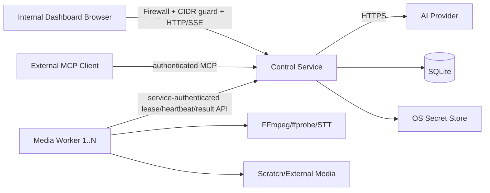

# 02. 실행 컨테이너와 컴포넌트 경계

## 1. 컨테이너 관계



## 2. Control Service

Control Service만 운영 DB에 직접 쓴다.

| 컴포넌트 | 책임 |
|---|---|
| HTTP Adapter | 인증, 요청 DTO, 오류 매핑, Notification SSE 연결 |
| MCP Adapter | 업무 의미 도구와 async task handle 제공 |
| Command Bus | envelope·권한·리비전 검사, idempotency, 상태·CommandRecord·Event·receipt Unit of Work |
| Workflow Engine | DAG, StepState, 재시도, Approval, ExecutionLease·fencing |
| Resource Scheduler | Worker metric과 정책으로 실행 허용 판단 |
| Agent Gateway | Provider routing, context, Tool Call, 폴백 |
| Repository Adapter | SQLite transaction과 projection |
| Sidecar Service | archive export/import |

각 도메인 기능은 protocol과 무관한 Application Capability Port로 먼저 제공한다. CLI, test, Scheduler, HTTP와 MCP는 같은 Capability Registry를 호출하므로 서버 Adapter가 없어도 기능 자체를 직접 실행할 수 있다. 장시간 기능은 동기 HTTP 응답을 붙잡지 않고 Job/Step ID를 반환한다. 세부 계약은 [10. 도메인 기능 실행과 검증 증적](10-capabilities-observability.md)을 따른다. `APP-001`

HTTP와 MCP는 Domain 함수를 직접 호출하지 않고 같은 Command Bus를 사용한다. Handler는 저장 상태를 직접 바꾸지 않고 새 상태와 Event를 반환하며 Store가 상태·CommandRecord·Event·receipt를 한 번에 확정한다. Core 경계는 `CMD-001~010`, 실제 SQLite transaction은 `PER-001` integration test로 검증한다.

## 3. Media Worker

Worker는 다음 순서로 단계 하나를 처리한다.

```text
lease claim
→ 입력 artifact와 storage reservation 확인
→ subprocess 시작
→ heartbeat/progress 전송
→ 임시 출력에 기록
→ 출력 probe/checksum/QC
→ atomic publish 요청
→ result 보고
```

Worker는 DB 파일을 직접 열지 않는다. Control API가 내려준 ID와 허용된 storage root만 사용하며, 임의의 사용자 제공 절대경로를 실행 인수로 신뢰하지 않는다.

같은 PC의 local Worker도 원격 Worker와 같은 registry·ExecutionLease 계약을 사용한다. PC를 추가할 때 Worker만 설치하고 boot config에 `worker_id`, credential reference, 처리 종류를 등록한다. 원격 Worker가 Control에 outbound 연결하므로 Worker PC에는 inbound 포트를 열지 않는다.

## 4. 프로세스 장애 경계

- Worker 종료는 Control Service와 Dashboard를 종료하지 않는다.
- Control 재시작 후 DB의 RUNNING ExecutionLease와 publish receipt를 검사하여 미게시 Step만 재대기한다. `WFL-004`, `WFL-009`, `EXE-003`
- subprocess 결과는 임시 경로에 쓰고 검증 전 Artifact로 게시하지 않는다. `EXE-001~002`
- Worker는 하나의 heavy slot만 lease할 수 있다. `RES-005`
- 같은 물리 장치 충돌은 논리 경로가 달라도 차단한다. `RES-006`

## 5. Adapter 계약

Adapter는 다음 변환만 담당한다.

```text
외부 입력
→ 인증/스키마 검증
→ Domain ID 기반 Command
→ Core 결과
→ 프로토콜별 응답
```

업무 규칙, 승인 우회, 상태 전이, Provider 오류 정책을 Adapter에 중복 구현하지 않는다.

## 6. 초기 통신 선택

- Dashboard: 명시한 사무실 NIC 주소에서만 Control Service의 정적 UI와 `/api/v1` 제공
- 실시간 알림: `/api/v1/notifications` SSE. Event 기반 Notification은 last Event ID 이후 replay하고 metric·진행률 Notification은 live로만 전달 `NTF-001~002`
- Worker: loopback 또는 LAN의 인증된 `/worker/v1` API로 lease/heartbeat/result 교환
- MCP: 인증 비활성 시 `127.0.0.1`/`::1`에만 listen하며 외부 공개 포트는 비활성
- Provider: Agent Gateway만 outbound HTTPS 사용

프로토콜 DTO는 Domain 구조체를 그대로 노출하지 않으며 versioned schema로 관리한다.

Dashboard의 `auth_mode: disabled`는 Worker API에 적용하지 않는다. Worker API는 개별 service credential을 항상 요구하고, loopback 밖에서는 TLS 또는 Tailscale 같은 암호화된 overlay를 사용한다.

## 7. 내부망 노출 경계

다음 세 계층을 동시에 적용한다.

1. Control Service는 지정한 내부 NIC IP에 bind하고 `0.0.0.0`을 기본값으로 사용하지 않는다.
2. Windows Defender Firewall inbound rule은 실제 사무실 CIDR과 포트만 허용한다.
3. 애플리케이션도 실제 socket peer IP를 CIDR allowlist로 다시 검사한다. `NET-001`

RFC1918 전체를 허용하지 않고 실제 사용하는 subnet만 기록한다. IPv6를 사용하지 않으면 IPv6 listen과 firewall inbound를 함께 끈다. Reverse proxy를 쓰지 않는 초기 구성에서는 `X-Forwarded-For`를 무시한다. 이후 proxy를 둘 때도 직접 peer가 명시된 trusted proxy인 경우만 전달 주소를 사용한다. `NET-007`
