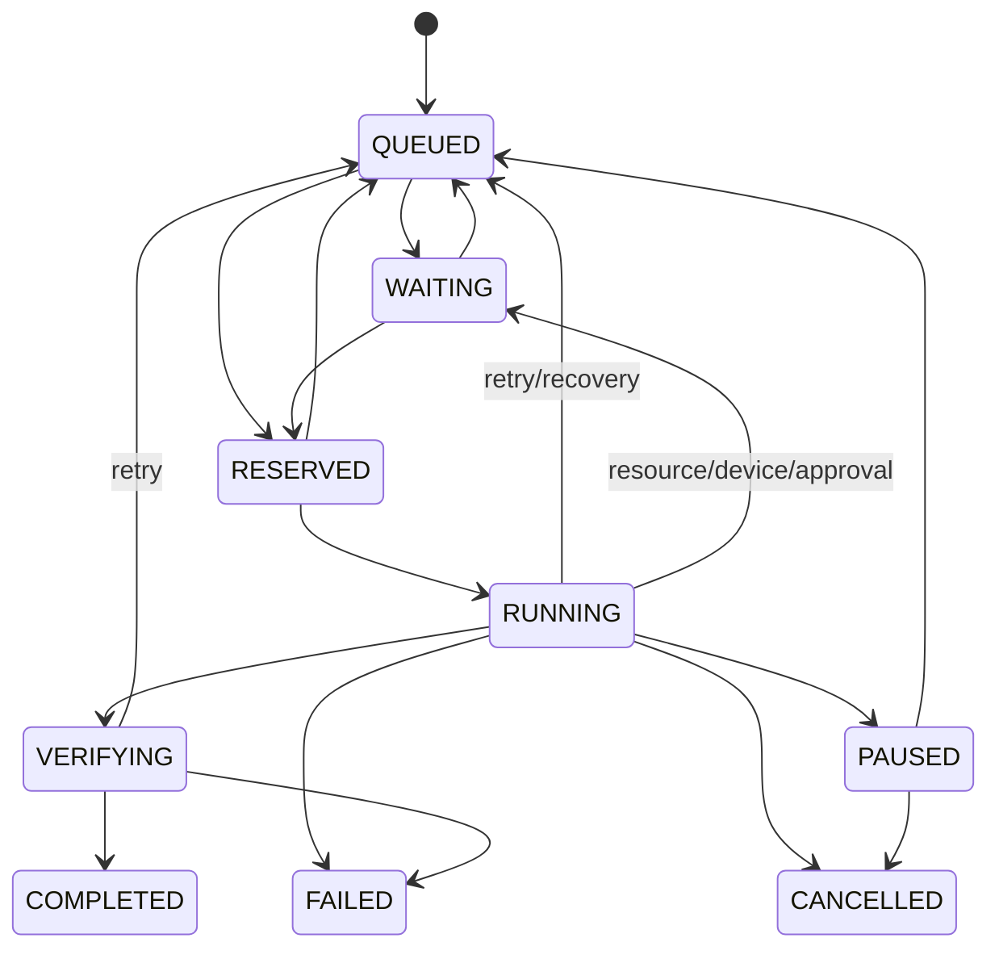

# 03. 도메인과 워크플로 설계

## 1. Bounded Context

| Context | 입력 | 출력 | 금지 사항 |
|---|---|---|---|
| Intake | 장치·파일 관찰값 | OriginalAsset, IntakeCopy | 원본 내용 변경 |
| Media Analysis | OriginalAsset | MediaInspection | 렌더 결과 생성 |
| Transcription | AudioArtifact | Transcript, Subtitle | 요약 사실 확정 |
| Content | Transcript | Summary, Keywords, Chapters | STT 원문 덮어쓰기 |
| VJ Assembly | 선택 clip과 in/out | Timeline | 직접 최종 렌더 |
| Rendering | Asset/Timeline + Profile | Rendition | 원본 대체 |
| QC | Artifact + Profile | QCReport | 아카이브 확정 |
| Catalog | 사람·AI 메타데이터 | CatalogRecord | 파일 이동 |
| Archive | 검증 결과와 승인 | ArchivePackage | 승인 없는 commit |
| Device | PhysicalDevice/Volume | lock, eject, format result | 업무 메타데이터 해석 |
| Workflow | Template + Command | Job/Step/Event | 영상 처리 자체 |

`InputFileObservation`은 등록 Storage root 안의 파일을 읽기 전용으로 검사해 고유 ID, `storage_id`, `workspace_drive_id`, 정규화 상대경로, 표시용 원래 이름, 크기와 checksum을 남기는 추가 전용 Record다. 절대 root는 기록에 포함하지 않으며, 이후 `RegisterOriginalAssets`가 checksum·원래 이름·크기와 관찰 기록 ID를 `OriginalAsset`에 고정한다. `INT-001`, `INT-002`

`MediaInspection`은 파일 자체가 아니라 `OriginalAsset`의 ID와 확정 checksum에 묶이는 추가 전용 기술정보 Record다. 컨테이너, 길이, 크기, bitrate, video/audio stream의 codec과 규격을 정규화해 렌더 프로파일 판정, QC와 검색이 함께 사용한다. 같은 원본을 다른 도구 버전으로 다시 분석하면 기존 기록을 덮어쓰지 않고 새 `MediaInspection`을 추가한다. `MED-001`

입고 카탈로그는 `InputFileObservation`, `OriginalAsset`, `MediaInspection`을 SQLite에 추가 전용으로 보존한다. 같은 ID와 같은 내용의 재전송만 멱등하게 허용하고 다른 내용은 덮어쓰지 않는다. OriginalAsset 등록값은 참조한 관찰 기록과 일치해야 하며, 중복 판정은 checksum이 같은 기존 자산을 후보로 반환할 뿐 자동 교체하거나 합치지 않는다. `INT-003~004`, `MED-004`

Audio Extraction은 versioned Profile로 원본 자산에서 STT 입력용 WAV/PCM 16-bit little-endian, 16kHz, mono `AudioArtifact`를 만든다. FFmpeg는 해석 완료된 입력 경로를 인수 배열로 받고 임시 출력을 검증한 뒤에만 게시하며, 원본 자산·Profile·처리기·Worker provenance를 남긴다. 실제 Windows FFmpeg와 대표 영상 검증은 장비 제공 전까지 acceptance 계획으로 둔다. `AUD-001~003`

Transcription은 경로가 아니라 provenance가 완전한 `AudioArtifact`를 입력으로 받는다. versioned STT Profile은 모델 식별자·언어·thread 상한을 고정하고, `whisper.cpp` Adapter는 해석 완료된 모델·오디오 경로를 인수 배열로 실행한다. Adapter는 임시 JSON의 언어와 겹치지 않는 시간 구간을 검증한 뒤 host 정보와 실제 모델 경로를 제거한 정규 Transcript JSON만 게시한다. Transcript는 공통 파일 생애주기와 provenance는 Artifact에서, 검색 가능한 언어·시간 구간 의미는 전용 구조에서 소유한다. 실제 Windows 모델·대표 한국어 음성 검증은 장비 제공 전까지 acceptance 계획으로 둔다. `TRN-001~003`

게시된 Transcript는 OriginalAsset별 SQLite 카탈로그에 추가 전용으로 저장한다. 전사 검색은 각 원본 자산의 가장 최근 Transcript만 사용하고 일치한 segment의 OriginalAsset ID, Transcript ID와 start/end millisecond를 반환해 영상 타임코드 이동을 지원한다. 아티팩트 경로는 검색 결과 계약에 포함하지 않는다. `TRN-004`, `CAT-003`

Subtitle은 Transcript의 해석 결과를 바꾸지 않고 같은 언어·순서·millisecond 구간을 versioned SRT Profile로 직렬화한 별도 Artifact다. 자막 파일 Adapter는 등록 Storage root 안에서 임시 SRT를 다시 읽어 바이트를 검증하고 같은 디렉터리로 원자 이동한 뒤 checksum·Transcript·Profile·처리기·Worker provenance를 남긴다. `SUB-001~002`

Summary는 Transcript와 분리된 리비전 대상 Artifact subtype이다. Summary ID와 리비전, 작성 주체(HUMAN 또는 AGENT), 정규화된 요약 text·키워드, Transcript 범위 안의 비중첩 시간 챕터를 가진다. AI를 사용할 수 없을 때도 사람이 같은 구조를 작성할 수 있으며 파일 Adapter는 등록 Storage root의 임시 JSON을 검증한 뒤 게시한다. SQLite에는 저장된 Transcript를 참조하는 Summary 리비전만 추가 전용으로 보존한다. 사람 검수는 Summary를 수정하지 않고 존재하는 ID와 리비전을 가리키는 ContentReview로 추가하며, 가장 큰 고유 Event 저장 순번을 현재 결정으로 투영한다. `SUM-001~003`, `REV-001~002`

Rendering은 versioned Profile만 실행한다. v1 `archive-event-1080p`는 호환성을 우선한 H.264/AAC MP4, 최대 1920×1080, 짝수 크기, 제한된 thread 수를 사용한다. FFmpeg는 인수 배열로 실행하고 같은 출력 디렉터리의 임시 파일을 검증한 뒤 원자적으로 게시하며, 게시된 파일의 checksum과 Profile·처리기·Worker를 Rendition provenance에 기록한다. 실제 Windows FFmpeg 검증 전까지 하드웨어 encoder는 허용 목록에 넣지 않는다. `RND-001~003`

QC는 렌더 요청값을 그대로 신뢰하지 않는다. 게시 파일을 ffprobe와 SHA-256으로 다시 관찰한 `OutputObservation`을 원본 `MediaInspection`, 렌더 Profile 및 Rendition과 비교한다. decodable·checksum·크기·container·video/audio codec·해상도·길이 검사가 모두 통과한 `QCAssessment`만 PASSED이며 각 검사의 기대값과 실제값을 보존한다. 이 평가는 다음 단계에서 provenance를 가진 `QCReport` sidecar로 게시한다. `QCT-001~002`

Catalog는 파일을 이동하거나 경로를 검색 키로 사용하지 않는다. 사람 또는 Agent가 작성한 제목·설명·키워드는 OriginalAsset별 추가 전용 `CatalogRecord` 리비전으로 남긴다. 자산 검색은 최신 CatalogRecord와 최신 MediaInspection을 결합해 text·video codec·길이 조건을 적용하며 OriginalAsset 콘텐츠 정체성을 반환한다. 전사 검색은 별도 segment hit 모델로 최신 Transcript의 timecode를 반환한다. `CAT-001~003`

## 2. 공통 Command

모든 상태 변경은 다음 의미를 가진다.

```text
command_id       감사용 요청 ID
command_type     도메인 업무 동작
actor            HUMAN / AGENT / WORKER / SYSTEM과 식별자
requested_via    dashboard / api / mcp / worker
target_id        경로가 아닌 도메인 ID
expected_revision optimistic concurrency 기준
idempotency_key  재전송 중복 방지 키
parameters       versioned command payload
reason           사람이 이해할 수 있는 실행 이유
```

검증 계약은 `CMD-001~010`이다. 의미가 같은 명령은 command ID나 요청 인터페이스가 달라도 최초 receipt를 반환하고, 같은 key의 의미가 다르면 충돌로 처리한다. 권한은 Handler와 리비전 조회보다 먼저 판정한다. Handler는 현재 상태의 복사본을 읽고 새 상태와 Event를 반환한다. Store는 새 상태·CommandRecord·Event·receipt를 하나의 Unit of Work로 확정하며, 일시 오류에는 receipt를 만들지 않는다. 실제 SQLite transaction은 `PER-001` integration test가 검증한다.

## 3. Workflow 상태



`WAITING`의 원인은 WaitReason.IDLE/MEMORY/SCRATCH/SLOT/DISK/APPROVAL/INPUT/DEVICE/PRIORITY로 분리한다. 모든 상태 변경 연산은 같은 전이표를 통과하고 자원 대기는 측정된 WaitReason을 그대로 기록한다. `COMPLETED`, `FAILED`, `CANCELLED`는 종결 상태다. 완료된 업무를 되돌려야 하면 기존 Step을 수정하지 않고 보상 Command와 새 Step/Event를 생성한다. 상태 계약은 `WFL-001~013`이다.

## 4. Lease와 복구

- ExecutionLease에는 `owner_worker_id`, `acquired_at`, `expires_at`, `heartbeat_at`, `fencing_token`을 둔다.
- Worker는 처리 중 주기적으로 heartbeat를 갱신한다.
- Control은 만료 전 동일 Step을 다른 Worker에 주지 않는다.
- 새 ExecutionLease의 fencing token은 이전 값보다 커야 하며 늦게 돌아온 Worker의 결과는 거부한다.
- 만료된 RUNNING Step은 idempotency receipt와 출력 publish 상태를 먼저 확인한다. 출력이 없을 때만 QUEUED로 복구하고 이미 게시됐으면 VERIFYING에서 조정한다.
- ControlMode를 MANUAL로 바꿔도 StepState와 Worker ExecutionLease는 유지한다.

## 5. Retry 분류

| 오류 | 기본 동작 |
|---|---|
| 일시적 process/network 오류 | max_attempts 안에서 backoff 후 QUEUED |
| 입력 손상/지원하지 않는 codec | FAILED, 사람 입력 필요 |
| 자원 부족 | 실패 횟수를 소비하지 않고 StepState.WAITING + 해당 WaitReason |
| 외장 장치 분리 | 실패 횟수를 소비하지 않고 StepState.WAITING + WaitReason.DEVICE |
| 승인 미완료 | StepState.WAITING + WaitReason.APPROVAL |
| 취소 | subprocess 종료·임시 결과 정리 후 CANCELLED |

재시도 한도 계약은 `WFL-005`, Provider 오류 재시도는 `AGT-004~006`이 소유한다.

## 6. Template

### 행사 기록

```text
intake → analyze ┬→ proxy ─────────────────────────┐
                 ├→ thumbnail ─────────────────────┼→ qc → stage_archive_package → archive_approval
                 └→ audio → transcript → summary → content_review ┘
→ copy_archive_primary → verify_archive_primary
→ copy_archive_mirror → verify_archive_mirror → commit_archive
```

Summary의 ExecutorKind는 AGENT_GATEWAY이고 AI 사용 불가 시 HUMAN 폴백을 사용한다. ContentReview는 사람이 남기는 별도 기록이며 Approval과 구분한다. 요구사항: `PIP-001`, `PIP-006`

### VJ

```text
intake → inspect_clips → select_ok_cuts → timeline → preview
→ timeline_approval → render → qc → stage_archive_package → archive_approval
→ copy/verify primary → copy/verify mirror → commit_archive
```

Timeline은 clip ID, in/out, 순서와 cut marker를 보존한다. Rendering이 Timeline을 소비한다. 요구사항: `PIP-002`

### 최종 편집본

```text
intake → duplicate_check → record_edit_version → analyze
→ proxy + representative_image → qc → record_delivery
```

요구사항: `PIP-003`

### 대용량 파일 입고

```text
inspect_inputs → register_original_assets
→ copy_first → verify_first
→ copy_second → verify_second
→ release_workspace_drive
```

입력은 미리 등록된 Storage와 선택된 파일 ID로 받는다. 작업 공간의 예약·I/O 충돌·해제 단위는 경로나 Volume이 아니라 PhysicalDevice다. 마지막 단계는 모든 사본 검증과 파일 handle 정리 뒤 Device Adapter로 해당 드라이브를 안전 제거한다. Template은 매체 소유권·반환·인수인계를 모델링하지 않으며 별도의 반환 승인을 요구하지 않는다.

요구사항: `PIP-004`

## 7. 사람 개입

실행 상태와 제어 주체는 별도 축이다.

```text
StepState: QUEUED/WAITING/RESERVED/RUNNING/VERIFYING/PAUSED/FAILED/COMPLETED/CANCELLED
ControlMode: AGENT/ASSISTED/MANUAL
```

Agent가 만든 변경 계획은 Command를 실행하기 전 Action Card로 표시한다. 승인 결과도 별도 Event로 남기며 대화 텍스트 자체를 승인으로 간주하지 않는다.
