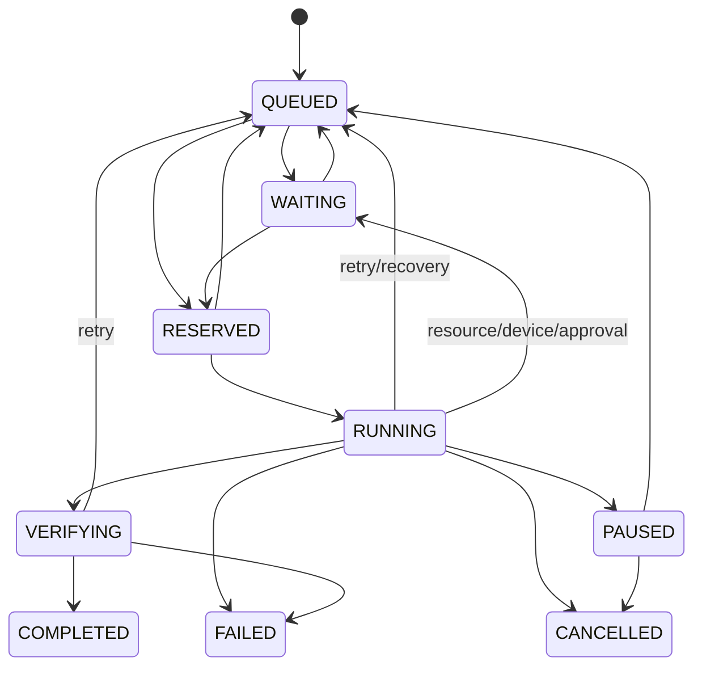

# 03. 도메인과 워크플로 설계

## 1. Bounded Context

| Context | 입력 | 출력 | 금지 사항 |
|---|---|---|---|
| Intake | 장치·파일 관찰값 | OriginalAsset, IntakeCopy | 원본 내용 변경 |
| Media Analysis | OriginalAsset | MediaInspection | 렌더 결과 생성 |
| Transcription | AudioArtifact | Transcript, Subtitle | 요약 사실 확정 |
| Content | Transcript | Summary, Keywords, Chapters | STT 원문 덮어쓰기 |
| VJ Assembly | 선택 clip과 in/out | Timeline | 직접 최종 렌더 |
| Rendering | Asset/Timeline + Profile | Rendition | 원본 대체 |
| QC | Artifact + Profile | QCReport | 아카이브 확정 |
| Catalog | 사람·AI 메타데이터 | CatalogRecord | 파일 이동 |
| Archive | 검증 결과와 승인 | ArchivePackage | 승인 없는 commit |
| Device | PhysicalDevice/Volume | lock, eject, format result | 업무 메타데이터 해석 |
| Workflow | Template + Command | Job/Step/Event | 영상 처리 자체 |

## 2. 공통 Command

모든 상태 변경은 다음 의미를 가진다.

```text
command_id       감사용 요청 ID
command_type     도메인 업무 동작
actor            HUMAN / AGENT / WORKER / SYSTEM과 식별자
requested_via    dashboard / api / mcp / worker
target_id        경로가 아닌 도메인 ID
expected_revision optimistic concurrency 기준
idempotency_key  재전송 중복 방지 키
parameters       versioned command payload
reason           사람이 이해할 수 있는 실행 이유
```

검증 계약은 `CMD-001~010`이다. 의미가 같은 명령은 command ID나 요청 인터페이스가 달라도 최초 receipt를 반환하고, 같은 key의 의미가 다르면 충돌로 처리한다. 권한은 Handler와 리비전 조회보다 먼저 판정한다. Handler는 현재 상태의 복사본을 읽고 새 상태와 Event를 반환한다. Store는 새 상태·CommandRecord·Event·receipt를 하나의 Unit of Work로 확정하며, 일시 오류에는 receipt를 만들지 않는다. 실제 SQLite transaction은 `PER-001` integration test가 검증한다.

## 3. Workflow 상태



`WAITING`의 원인은 WaitReason.IDLE/MEMORY/SCRATCH/SLOT/DISK/APPROVAL/INPUT/DEVICE/PRIORITY로 분리한다. 모든 상태 변경 연산은 같은 전이표를 통과하고 자원 대기는 측정된 WaitReason을 그대로 기록한다. `COMPLETED`, `FAILED`, `CANCELLED`는 종결 상태다. 완료된 업무를 되돌려야 하면 기존 Step을 수정하지 않고 보상 Command와 새 Step/Event를 생성한다. 상태 계약은 `WFL-001~013`이다.

## 4. Lease와 복구

- ExecutionLease에는 `owner_worker_id`, `acquired_at`, `expires_at`, `heartbeat_at`, `fencing_token`을 둔다.
- Worker는 처리 중 주기적으로 heartbeat를 갱신한다.
- Control은 만료 전 동일 Step을 다른 Worker에 주지 않는다.
- 새 ExecutionLease의 fencing token은 이전 값보다 커야 하며 늦게 돌아온 Worker의 결과는 거부한다.
- 만료된 RUNNING Step은 idempotency receipt와 출력 publish 상태를 먼저 확인한다. 출력이 없을 때만 QUEUED로 복구하고 이미 게시됐으면 VERIFYING에서 조정한다.
- ControlMode를 MANUAL로 바꿔도 StepState와 Worker ExecutionLease는 유지한다.

## 5. Retry 분류

| 오류 | 기본 동작 |
|---|---|
| 일시적 process/network 오류 | max_attempts 안에서 backoff 후 QUEUED |
| 입력 손상/지원하지 않는 codec | FAILED, 사람 입력 필요 |
| 자원 부족 | 실패 횟수를 소비하지 않고 StepState.WAITING + 해당 WaitReason |
| 외장 장치 분리 | 실패 횟수를 소비하지 않고 StepState.WAITING + WaitReason.DEVICE |
| 승인 미완료 | StepState.WAITING + WaitReason.APPROVAL |
| 취소 | subprocess 종료·임시 결과 정리 후 CANCELLED |

재시도 한도 계약은 `WFL-005`, Provider 오류 재시도는 `AGT-004~006`이 소유한다.

## 6. Template

### 행사 기록

```text
intake → analyze ┬→ proxy ─────────────────────────┐
                 ├→ thumbnail ─────────────────────┼→ qc → stage_archive_package → archive_approval
                 └→ audio → transcript → summary → content_review ┘
→ copy_archive_primary → verify_archive_primary
→ copy_archive_mirror → verify_archive_mirror → commit_archive
```

Summary의 ExecutorKind는 AGENT_GATEWAY이고 AI 사용 불가 시 HUMAN 폴백을 사용한다. ContentReview는 사람이 남기는 별도 기록이며 Approval과 구분한다. 요구사항: `PIP-001`, `PIP-006`

### VJ

```text
intake → inspect_clips → select_ok_cuts → timeline → preview
→ timeline_approval → render → qc → stage_archive_package → archive_approval
→ copy/verify primary → copy/verify mirror → commit_archive
```

Timeline은 clip ID, in/out, 순서와 cut marker를 보존한다. Rendering이 Timeline을 소비한다. 요구사항: `PIP-002`

### 최종 편집본

```text
intake → duplicate_check → record_edit_version → analyze
→ proxy + representative_image → qc → record_delivery
```

요구사항: `PIP-003`

### 원본 매체 입고

```text
detect → inspect → role
→ copy_first → verify_first
→ copy_second → verify_second
→ return_approval → safe_eject
```

요구사항: `PIP-004`

## 7. 사람 개입

실행 상태와 제어 주체는 별도 축이다.

```text
StepState: QUEUED/WAITING/RESERVED/RUNNING/VERIFYING/PAUSED/FAILED/COMPLETED/CANCELLED
ControlMode: AGENT/ASSISTED/MANUAL
```

Agent가 만든 변경 계획은 Command를 실행하기 전 Action Card로 표시한다. 승인 결과도 별도 Event로 남기며 대화 텍스트 자체를 승인으로 간주하지 않는다.
