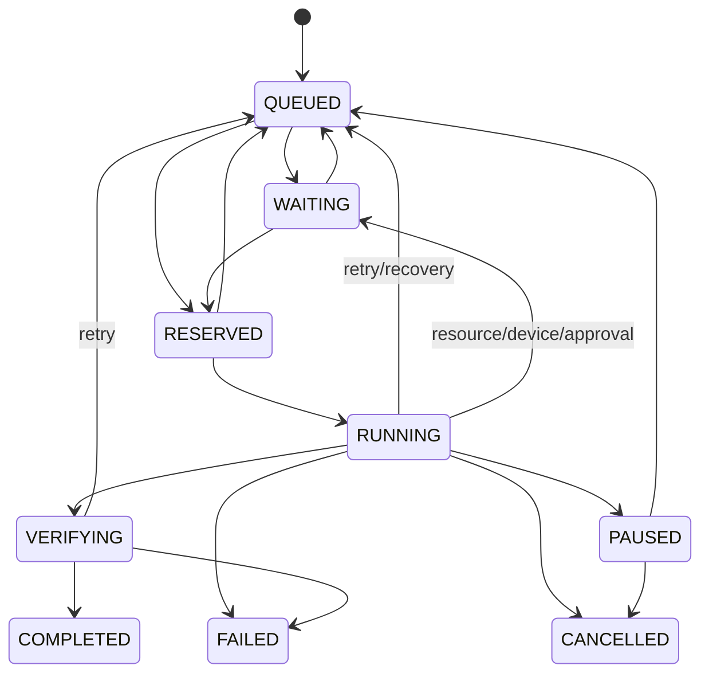

# 03. 도메인과 워크플로 설계

## 1. Bounded Context

| Context | 입력 | 출력 | 금지 사항 |
|---|---|---|---|
| Intake | 장치·파일 관찰값 | OriginalAsset, IntakeCopy | 원본 내용 변경 |
| Media Analysis | OriginalAsset | MediaInspection | 렌더 결과 생성 |
| Transcription | AudioArtifact | Transcript, Subtitle | 요약 사실 확정 |
| Content | Transcript | Summary, Keywords, Chapters | STT 원문 덮어쓰기 |
| VJ Assembly | 선택 clip과 in/out | Timeline | 직접 최종 렌더 |
| Rendering | Asset/Timeline + Profile | Rendition | 원본 대체 |
| QC | Artifact + Profile | QCReport | 아카이브 확정 |
| Catalog | 사람·AI 메타데이터 | CatalogRecord | 파일 이동 |
| Archive | 검증 결과와 승인 | ArchivePackage | 승인 없는 commit |
| Device | PhysicalDevice/Volume | lock, eject, format result | 업무 메타데이터 해석 |
| Workflow | Template + Command | Job/Step/Event | 영상 처리 자체 |

`InputFileObservation`은 등록 Storage root 안의 파일을 읽기 전용으로 검사해 고유 ID, `storage_id`, `workspace_drive_id`, 정규화 상대경로, 표시용 원래 이름, 크기와 checksum을 남기는 추가 전용 Record다. 절대 root는 기록에 포함하지 않으며, 이후 `RegisterOriginalAssets`가 checksum·원래 이름·크기와 관찰 기록 ID를 `OriginalAsset`에 고정한다. `INT-001`, `INT-002`

`MediaInspection`은 파일 자체가 아니라 `OriginalAsset`의 ID와 확정 checksum에 묶이는 추가 전용 기술정보 Record다. 컨테이너, 길이, 크기, 전체 bitrate, video/audio stream의 codec·규격과 stream bitrate를 정규화해 렌더 프로파일 판정, QC와 검색이 함께 사용한다. 값이 없는 stream bitrate는 0으로 보존하며 추정하지 않는다. 같은 원본을 다른 도구 버전으로 다시 분석하면 기존 기록을 덮어쓰지 않고 새 `MediaInspection`을 추가한다. `MED-001`, `MED-005~006`

입고 카탈로그는 `InputFileObservation`, `OriginalAsset`, `MediaInspection`을 SQLite에 추가 전용으로 보존한다. 같은 ID와 같은 내용의 재전송만 멱등하게 허용하고 다른 내용은 덮어쓰지 않는다. OriginalAsset 등록값은 참조한 관찰 기록과 일치해야 하며, 중복 판정은 checksum이 같은 기존 자산을 후보로 반환할 뿐 자동 교체하거나 합치지 않는다. `INT-003~004`, `MED-004`

Audio Extraction은 versioned Profile로 원본 자산에서 STT 입력용 WAV/PCM 16-bit little-endian, 16kHz, mono `AudioArtifact`를 만든다. FFmpeg는 해석 완료된 입력 경로를 인수 배열로 받고 임시 출력을 검증한 뒤에만 게시하며, 원본 자산·Profile·처리기·Worker provenance를 남긴다. 실제 Windows FFmpeg와 대표 영상 검증은 장비 제공 전까지 acceptance 계획으로 둔다. `AUD-001~003`

Transcription은 경로가 아니라 provenance가 완전한 `AudioArtifact`를 입력으로 받는다. versioned STT Profile은 모델 식별자·언어·thread 상한을 고정하고, `whisper.cpp` Adapter는 해석 완료된 모델·오디오 경로를 인수 배열로 실행한다. 긴 PCM 입력은 전체를 한 subprocess에 맡기지 않고 무음 구간의 가운데를 우선 경계로 삼아 제한 길이 청크로 나눈다. 제한 구간 안에 충분한 무음이 없으면 가장 조용한 관측 창을 경계로 정하고 문장 손실을 줄이는 문맥 겹침을 주되, 각 구간의 중앙점 소유 규칙으로 중복 segment를 제거한다. Adapter는 청크별 상대 시각을 원본 영상의 전역 millisecond 시간축으로 합치고 겹치지 않는 구간을 검증한 뒤 host 정보와 실제 모델 경로를 제거한 정규 Transcript JSON만 게시한다. Transcript는 공통 파일 생애주기와 provenance는 Artifact에서, 검색 가능한 언어·전역 시간 구간 의미는 전용 구조에서 소유한다. 실제 Windows 모델·대표 한국어 음성 검증은 장비 제공 전까지 acceptance 계획으로 둔다. `TRN-001~003`

게시 직후 Worker는 `transcript-quality@v1` 결정 규칙으로 Transcript의 구간 길이와 문자 밀도를 평가한다. 15초를 넘는 구간은 `SEGMENT_TOO_LONG`, 5초 이상 결과에서 초당 문자 수가 1 미만이면 `LOW_TEXT_DENSITY`이며 하나라도 있으면 `REVIEW_RECOMMENDED`다. 판정은 policy reference, 전체 길이, 구간 수, 문자 수와 함께 transcript Step 출력 기록에 저장한다. 이는 사람이 확인한 ContentReview가 아니고 STT 성공이나 Job 완료를 되돌리지 않으며, 화면의 별도 확인 필요 신호만 만든다. `TRN-007`

게시된 Transcript는 OriginalAsset별 SQLite 카탈로그에 추가 전용으로 저장한다. 전사 검색은 각 원본 자산의 가장 최근 Transcript만 사용하고 일치한 segment의 OriginalAsset ID, Transcript ID와 start/end millisecond를 반환해 영상 타임코드 이동을 지원한다. 아티팩트 경로는 검색 결과 계약에 포함하지 않는다. `TRN-004`, `CAT-003`

Subtitle은 Transcript의 해석 결과를 바꾸지 않고 같은 언어·순서·millisecond 구간을 versioned SRT Profile로 직렬화한 별도 Artifact다. 자막 파일 Adapter는 등록 Storage root 안에서 임시 SRT를 다시 읽어 바이트를 검증하고 같은 디렉터리로 원자 이동한 뒤 checksum·Transcript·Profile·처리기·Worker provenance를 남긴다. `SUB-001~002`

Summary는 Transcript와 분리된 리비전 대상 Artifact subtype이다. Summary ID와 리비전, 작성 주체(HUMAN 또는 ARCHIVIST), 정규화된 요약 text·키워드, Transcript 범위 안의 비중첩 시간 챕터를 가진다. AI를 사용할 수 없을 때도 사람이 같은 구조를 작성할 수 있으며 파일 Adapter는 등록 Storage root의 임시 JSON을 검증한 뒤 게시한다. SQLite에는 저장된 Transcript를 참조하는 Summary 리비전만 추가 전용으로 보존한다. 사람 검수는 Summary를 수정하지 않고 존재하는 ID와 리비전을 가리키는 ContentReview로 추가하며, 가장 큰 고유 Event 저장 순번을 현재 결정으로 투영한다. `SUM-001~003`, `REV-001~002`

Rendering은 versioned Profile만 실행한다. v1 `archive-event-1080p`는 호환성을 우선한 H.264/AAC MP4, 최대 1920×1080, 짝수 크기, 제한된 thread 수를 사용한다. FFmpeg는 인수 배열로 실행하고 같은 출력 디렉터리의 임시 파일을 검증한 뒤 원자적으로 게시하며, 게시된 파일의 checksum과 Profile·처리기·Worker를 Rendition provenance에 기록한다. 실제 Windows FFmpeg 검증 전까지 하드웨어 encoder는 허용 목록에 넣지 않는다. `RND-001~003`

QC는 렌더 요청값을 그대로 신뢰하지 않는다. 게시 파일을 ffprobe와 SHA-256으로 다시 관찰한 `OutputObservation`을 원본 `MediaInspection`, 렌더 Profile 및 Rendition과 비교한다. decodable·checksum·크기·container·video codec·해상도·길이와 원본의 오디오 유무가 요구하는 audio codec 검사가 모두 통과한 `QCAssessment`만 PASSED다. 원본에 오디오가 있으면 AAC를, 없으면 오디오 스트림 부재를 기대값으로 보존한다. 이 평가는 다음 단계에서 provenance를 가진 `QCReport` sidecar로 게시한다. `QCT-001~002`

Catalog는 파일을 이동하거나 경로를 검색 키로 사용하지 않는다. 사람 또는 Archivist가 작성한 제목·설명·키워드는 OriginalAsset별 추가 전용 `CatalogRecord` 리비전으로 남긴다. 자산 검색은 최신 CatalogRecord와 최신 MediaInspection을 결합해 text·video codec·길이 조건을 적용하며 OriginalAsset 콘텐츠 정체성을 반환한다. 전사 검색은 별도 segment hit 모델로 최신 Transcript의 timecode를 반환한다. `CAT-001~003`

새 드라이브의 Worker 원격 탐색, 폴더 범위 고정, 6Mbps·20Mbps 렌더, 소스 시퀀스와 CutMarker, ARCHIVE_PRIMARY 보관, 별도 STT 단계와 ArchiveCatalog는 [13. Archive Intake](13-archive-intake.md)가 소유한다. run 영수증과 분리된 ArchiveRun은 사람의 선택 참조, 고정 FolderScope와 두 단계 소유권을 보존하는 영속 업무 identity다. 현재 ArchiveRun은 진행 상태 전이를 직접 저장하지 않으며 최신 OrganizationDecision과 소유 Job의 StepState에서 1·2단계 상태를 투영한다. 자동 판정은 기술 관찰값과 versioned policy만 사용하며 모호한 입력은 `WaitReason.INPUT`인 보류로 남긴다. 명시적 분류로 HOLD가 해소되면 같은 ArchiveRun 문맥의 후속 Folder Job을 멱등하게 연결한다. `DEV-007~010`, `DEV-012`, `ORG-001~014`, `PIP-007~009`, `APP-002`, `APP-006~007`, `DSH-006~013`

## 2. 공통 Command

모든 상태 변경은 다음 의미를 가진다.

```text
command_id       감사용 요청 ID
command_type     도메인 업무 동작
actor            HUMAN / ARCHIVIST / WORKER / SYSTEM과 식별자
requested_via    archive_workspace / api / mcp / worker
target_id        경로가 아닌 도메인 ID
expected_revision optimistic concurrency 기준
idempotency_key  재전송 중복 방지 키
parameters       versioned command payload
reason           사람이 이해할 수 있는 실행 이유
```

검증 계약은 `CMD-001~010`이다. 의미가 같은 명령은 command ID나 요청 인터페이스가 달라도 최초 receipt를 반환하고, 같은 key의 의미가 다르면 충돌로 처리한다. 권한은 Handler와 리비전 조회보다 먼저 판정한다. Handler는 현재 상태의 복사본을 읽고 새 상태와 Event를 반환한다. Store는 새 상태·CommandRecord·Event·receipt를 하나의 Unit of Work로 확정하며, 일시 오류에는 receipt를 만들지 않는다. 실제 SQLite transaction은 `PER-001` integration test가 검증한다.

## 3. Workflow 상태



`WAITING`의 원인은 WaitReason.IDLE/MEMORY/SCRATCH/SLOT/DISK/APPROVAL/INPUT/DEVICE/PRIORITY로 분리한다. 모든 상태 변경 연산은 같은 전이표를 통과하고 자원 대기는 측정된 WaitReason을 그대로 기록한다. `COMPLETED`, `FAILED`, `CANCELLED`는 종결 상태다. 완료되거나 실패한 업무를 되돌려야 하면 기존 Step을 수정하지 않고 보상 Command 또는 근거가 연결된 새 복구 Job/Event를 생성한다. 미시작·실행 중 Worker 취소, 완료 경합과 외부 효과 PARTIAL·UNCERTAIN 조정은 `CAN-001~005`로 확정했고, 업무 보상 후보는 [12. 취소와 보상 설계 제안](12-cancellation-compensation-proposal.md)에서 분리한다. 상태 계약은 `WFL-001~015`이다.

`QUEUED`는 단순 배열 위치가 아니라 dispatch 가능성을 나타낸다. Step에는 선행 조건을 처음 만족한 `ready_at`과 재시도 backoff용 `next_eligible_at`을 두고, Job에는 마지막 성공 dispatch sequence를 둔다. 이 값은 queue projection을 재구성하고 Control 재시작 전후 같은 다음 후보를 선택하는 근거이며 Worker lease가 실제로 확정되기 전에는 갱신하지 않는다. 순서와 공정성 계약은 `DSP-001`이 소유한다.

## 4. Lease와 복구

- ExecutionLease에는 `owner_worker_id`, `acquired_at`, `expires_at`, `heartbeat_at`, `fencing_token`을 둔다.
- ExecutionLease 발급 전에 같은 Worker·Step의 ResourceReservation을 만들고 둘을 StepState.RESERVED와 같은 Unit of Work로 확정한다.
- Worker는 처리 중과 결과 HTTP 재전송 중 Control이 내려준 상대 주기로 현재 owner·fencing token의 heartbeat를 갱신한다. `WRK-013`
- Control은 만료 전 동일 Step을 다른 Worker에 주지 않는다.
- 새 ExecutionLease의 fencing token은 이전 값보다 커야 하며 늦게 돌아온 Worker의 결과는 거부한다.
- 결과 정산은 같은 token의 동일 결과를 replay하는 결과 receipt와 후속 observer용 completion outbox를 같은 transaction에 기록한다. `WRK-009`, `WRK-014`
- 만료된 RUNNING Step은 idempotency receipt와 결과 receipt를 먼저 확인한다. 실제 게시 파일은 있지만 결과 receipt가 없는 중단을 자동 조정하는 경계는 `EXE-003` planned이므로 그 경우를 안전한 재실행으로 간주하지 않는다.
- 사람과 Archivist 사이에서 같은 영속 작업을 이어가도 StepState와 Worker ExecutionLease는 유지한다.

Archivist의 직접 복구는 범용 retry가 아니다. `WorkDiagnostic.recovery_actions`가 `RECONCILE_EXPIRED_EXECUTION`을 반환한 경우에만 현재 고정 작업의 Job revision, Step, ResourceReservation, fencing token, 진단 fingerprint와 basis 증적 ID를 그대로 제출한다. Core Handler는 실제 Job의 만료 리스와 전이 가능 상태를 다시 확인하고 `QUEUED` 변경과 `StepRecoveryEvidence`를 staged change로 반환한다. SQLite Unit of Work는 상태·CommandRecord·Domain Event·idempotency receipt와 ExecutionLease·ResourceReservation 해제를 함께 확정한다. 실패한 commit은 모두 되돌리고 같은 key 재전송은 최초 결과만 반환한다. `WFL-014`

종결 실패는 원래 Step을 다시 열지 않는다. 마지막 `StepFailureEvidence`가 `TRANSIENT`이고 operation이 패키지 리비전 또는 아카이브 카탈로그 게시이며 활성 실행 경계가 없을 때만 진단이 `RETRY_TERMINAL_ARCHIVE_PUBLICATION`을 반환한다. 복구 서비스는 source Job·revision·Step·fencing token·진단 fingerprint·실패 증적 ID를 다시 대조하고, 그 증적에서 결정적으로 계산한 ID의 `archive-publication-recovery` Job을 새로 만든다. 새 Job의 `RecoverySource`는 원래 실패와 근거를 보존하고 Worker는 패키지의 현재 리비전과 동일 전사 산출물을 확인한 뒤 필요한 리비전과 최상위 카탈로그를 멱등하게 재조정한다. 원래 Job과 실패 증적은 계속 `FAILED`이며 입력 오류·장치 부재·취소·임의 operation은 이 경로에 포함하지 않는다. `WFL-015`, `WRK-018`

## 5. Retry 분류

| 오류 | 기본 동작 |
|---|---|
| 일시적 process/network 오류 | max_attempts 안에서 backoff 후 QUEUED |
| 입력 손상/지원하지 않는 codec | FAILED, 사람 입력 필요 |
| 자원 부족 | 실패 횟수를 소비하지 않고 StepState.WAITING + 해당 WaitReason |
| 외장 장치 분리 | 실패 횟수를 소비하지 않고 StepState.WAITING + WaitReason.DEVICE |
| 승인 미완료 | StepState.WAITING + WaitReason.APPROVAL |
| 취소 | subprocess 종료·임시 결과 정리 후 CANCELLED. 종료 뒤 외부 효과가 남으면 PARTIAL, 종료 여부가 불명확하면 UNCERTAIN과 Worker 격리 |

재시도 한도 계약은 `WFL-005`, 운영 Worker 오류 분류는 `WRK-015`가 소유한다. 외부 Provider 오류 재시도 `AGT-004~006`은 Provider Router 연결 전까지 planned다.

## 6. Template

### 행사 기록

```text
intake → analyze ┬→ proxy ─────────────────────────┐
                 ├→ thumbnail ─────────────────────┼→ qc → stage_archive_package → archive_approval
                 └→ audio → transcript → summary → content_review ┘
→ copy_archive_primary → verify_archive_primary
→ copy_archive_mirror → verify_archive_mirror → commit_archive
```

Summary의 ExecutorKind는 ARCHIVIST_GATEWAY이고 AI 사용 불가 시 HUMAN 폴백을 사용한다. ContentReview는 사람이 남기는 별도 기록이며 Approval과 구분한다. 요구사항: `PIP-001`, `PIP-006`

### VJ

```text
intake → inspect_clips → select_ok_cuts → timeline → preview
→ timeline_approval → render → qc → stage_archive_package → archive_approval
→ copy/verify primary → copy/verify mirror → commit_archive
```

Timeline은 clip ID, in/out, 순서와 cut marker를 보존한다. Rendering이 Timeline을 소비한다. 요구사항: `PIP-002`

### 최종 편집본

```text
intake → duplicate_check → record_edit_version → analyze
→ proxy + representative_image → qc → record_delivery
```

요구사항: `PIP-003`

### 대용량 파일 입고

```text
inspect_inputs → register_original_assets
→ copy_first → verify_first
→ copy_second → verify_second
→ release_workspace_drive
```

입력은 미리 등록된 Storage와 선택된 파일 ID로 받는다. 작업 공간 선택·표시·파일 handle 정리 단위는 mount 경로가 아닌 stable 논리 Volume이고, 같은 물리 매체의 동시 I/O 충돌과 실제 장치 안전 제거 판정에는 별도 PhysicalDevice ID를 사용한다. 마지막 단계는 모든 사본 검증과 해당 Volume handle 정리 뒤 다른 Volume과 lock까지 확인해 Device Adapter로 장치를 안전 제거한다. Template은 매체 소유권·반환·인수인계를 모델링하지 않으며 별도의 반환 승인을 요구하지 않는다.

요구사항: `PIP-004`

### 드라이브 미디어 정리

```text
1단계: discover → inspect → classify
├→ 그대로 사용 → qc → archive package → archive_catalog
├→ 개별 렌더 → qc → archive package → archive_catalog
├→ 소스 Timeline → marker → 20Mbps render → qc → archive package → archive_catalog
└→ HOLD → 사람 또는 허용된 Archivist의 명시적 분류 입력 대기

2단계 Command: stored recording → audio → transcript → subtitle → package revision → archive_catalog
```

SOURCE_MEDIA 원본은 이동하거나 이름을 바꾸지 않는다. 1단계 Folder Job은 검사·분류·렌더·QC·보관만 포함하고 STT를 넣지 않는다. 1단계에 실행 가능한 작업이 없을 때만 별도 2단계 Command가 보관됨 녹화영상 중 원본 기술정보에 오디오가 있는 대상에 오디오·STT·자막·패키지 추가를 만든다. 무음 영상·소스 시퀀스·HOLD는 STT 대상에서 제외하고, HOLD만 게이트의 남은 실행 작업에서도 제외한다. 사람 또는 Archivist의 분류는 최신 입력 revision을 고정한 새 OrganizationDecision으로 기록한다. 요구사항: `ORG-007`, `PIP-007~009`, `APP-002`, `MCP-004~005`

## 7. 사람 개입

실행 상태와 제어 주체는 별도 축이다.

```text
StepState: QUEUED/WAITING/RESERVED/RUNNING/VERIFYING/PAUSED/FAILED/COMPLETED/CANCELLED
Collaboration actor: HUMAN/ARCHIVIST (Command마다 기록하며 Step 속성이 아님)
```

Archivist가 만든 변경 계획은 Command를 실행하기 전 Action Card로 표시한다. 승인 결과도 별도 Event로 남기며 대화 텍스트 자체를 승인으로 간주하지 않는다.
