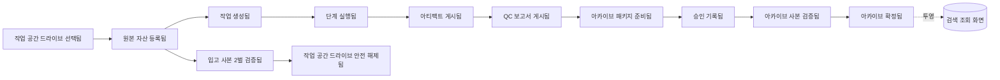
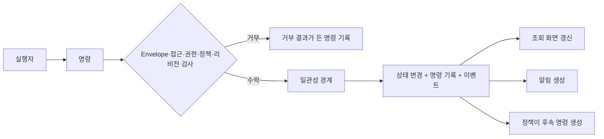

# 08. 이벤트 스토밍

## 1. 목적과 범위

이 문서는 [`ontology/terms.json`](../../ontology/terms.json)의 결정된 용어로 시스템의 업무 흐름을 시간순으로 펼친 결과다. 구현 구조를 먼저 정하지 않고 다음을 찾는 데 목적이 있다.

1. 담당자, Archivist, Worker와 시스템 정책이 어떤 명령을 만드는가
2. 명령이 성공했을 때 어떤 상태 변경 사실을 이벤트로 남기는가
3. 이벤트 뒤에 어떤 정책과 다음 명령이 이어지는가
4. 한 원자 단위로 지켜야 하는 불변식의 소유자가 무엇인가
5. 요구사항을 쓰기 전에 결정해야 할 핫스팟이 무엇인가

여기서 이벤트는 저장되는 도메인 상태 변경 기록만 뜻한다. 진행률, CPU 사용률, 로그와 SSE 메시지는 각각 증적과 알림이며 이벤트가 아니다. 표의 명령·이벤트 이름은 설계 후보이고, 카탈로그에 요구사항으로 등록되어 구현되기 전까지 공개 계약은 아니다.

## 2. 표기

| 표기 | 의미 | 저장 여부 |
|---|---|---|
| 실행자 | 명령을 시작하는 Actor | 명령 기록에 포함 |
| 명령 | 상태 변경 의도 | 명령 자체 대신 처리 시도와 결과를 명령 기록으로 저장 |
| 일관성 경계 후보 | 명령을 판단하고 불변식을 지킬 책임 후보 | 구현 결정 전 후보 |
| 이벤트 | 이미 일어난 상태 변경 사실 | 추가 전용 저장 |
| 정책 | 이벤트를 보고 다음 명령을 결정하는 규칙 | 정책 정의와 실행 결과를 분리 |
| 조회 화면 | 이벤트와 현재 상태를 읽기 좋게 투영한 결과 | 다시 만들 수 있음 |
| 외부 실행 | FFmpeg, 파일시스템, OS 장치 API, Provider API 호출 | DB transaction 밖에서 수행 |
| 핫스팟 | 추가 결정이나 실험이 필요한 지점 | §12에서 관리 |

이벤트 이름은 과거형, 명령 이름은 동사형으로 쓴다. 거부된 명령은 명령 기록에는 남지만 상태가 바뀌지 않았으므로 이벤트를 만들지 않는다.

## 3. 큰 흐름



행사 기록, VJ 통합, 최종 편집본은 원본 자산 이후 서로 다른 템플릿으로 작업을 만들지만, 단계 실행과 아카이브 확정은 같은 공통 흐름을 사용한다.

Archive Intake에서는 담당자가 Worker·원본 드라이브·아카이브 저장소·탐색 revision의 폴더 범위를 고른 뒤 1단계를 시작한다. Worker는 탐색·검사 관찰값을 보고하고 Control의 결정 정책이 `OrganizationDecisionRecorded`를 남긴다. `HOLD`는 `WaitReason.INPUT`으로 사람 또는 허용된 Archivist의 명시적 분류를 기다리며 다른 폴더를 막지 않는다. 비보류 Folder Job은 렌더·QC·ARCHIVE_PRIMARY 보관까지만 수행하고 STT는 별도 2단계 Command로 시작한다. `DEV-010`, `ORG-001~011`, `PIP-007~009`, `APP-002`, `APP-006`

완료된 같은 원본 범위를 다시 시작하면 새 ArchiveRun이 독립된 검사·판정·Folder Job을 소유한다. 동일한 Observation과 OriginalAsset identity는 중복 등록하지 않고 재사용하며, 같은 ArchiveRun의 멱등 재전송과 새 ArchiveRun 시작을 구분한다. `APP-002`

## 4. 모든 상태 변경에 공통인 흐름



공통 불변식은 다음과 같다.

- Handler보다 먼저 접근·권한·정책을 판정한다.
- 모든 명령 시도는 수락과 거부를 포함해 명령 기록으로 남긴다.
- 수락된 명령의 상태 변경, 명령 기록, 이벤트는 같은 DB transaction에 기록한다.
- 이벤트는 원인이 된 명령 기록을 `command_id`로 참조한다.
- 정책이 자동으로 만든 명령은 ActorType.SYSTEM 실행자를 가진다.
- 같은 idempotency key의 재전송은 현재 리비전보다 저장된 명령 결과를 먼저 확인한다.
- Worker 결과는 현재 실행 리스의 펜싱 토큰과 일치할 때만 받는다.
- 파일시스템과 subprocess는 DB transaction에 포함할 수 없으므로 임시 출력 → 검증 → 게시 명령 순서로 연결한다.

## 5. 대용량 파일 입고와 작업 공간 해제

| 순서 | 실행자·계기 | 명령 | 일관성 경계 후보 | 이벤트 | 정책·다음 동작 |
|---:|---|---|---|---|---|
| 1 | 담당자 또는 정책 범위의 Archivist | `SelectWorkspaceDrive` | Volume·Storage | `WorkspaceDriveSelected` | 선택한 storage_id를 stable Volume ID로 해석하고 PhysicalDevice I/O 충돌 키를 별도 보존 |
| 2 | Worker | `InspectInputFiles` | Step | `InputFilesInspected` | 등록 root 안의 파일만 원본 등록 후보로 전달 |
| 3 | 담당자 또는 시스템 | `RegisterOriginalAssets` | OriginalAsset | `OriginalAssetRegistered` | 파일별 최초 체크섬과 표시용 원래 이름을 고정 |
| 4 | 시스템 정책 | `CreateAndVerifyIntakeCopy(copy=first)` | IntakeCopy | `IntakeCopyVerified` | 첫 사본의 대상 Storage와 checksum을 기록 |
| 5 | 시스템 정책 | `CreateAndVerifyIntakeCopy(copy=second)` | IntakeCopy | `IntakeCopyVerified` | 두 번째 사본을 복사·검증 |
| 6 | 시스템 정책 | `RequestWorkspaceDriveRelease` | PhysicalDevice | `WorkspaceDriveReleaseRequested` | 두 검증 완료, 활성 lock·파일 handle 없음, 후속 Step 사용 없음 확인 |
| 7 | Worker의 장치 어댑터 | `ReportWorkspaceDriveReleased` | PhysicalDevice | `WorkspaceDriveReleased` | Job의 대용량 파일 입고 단계 완료 |

핵심 예외 흐름:

- 체크섬 불일치: 입고 사본을 등록하지 않고 해당 Step을 실패 또는 입력 대기로 전환한다.
- 장치 분리: 시도 횟수를 소비하지 않고 WaitReason.DEVICE로 기다린다.
- 같은 내용의 원본 자산: 자동 덮어쓰지 않고 중복 후보를 조회 화면에 표시한다.
- 작업 공간 해제 요청 전에 새 Step이 같은 PhysicalDevice lock을 획득함: 해제를 거부하고 현재 Job 상태를 다시 평가한다.

이 흐름의 안전 해제는 OS 장치 동작이며 매체 소유권 반환이나 사람의 반환 승인이 아니다. `PIP-004`, `ARC-001`, `DEV-006`은 현재 계약이고 실제 장치 lock·eject의 `DEV-001~003`은 planned다.

### 5.1 Archive Intake

아카이브 실행의 영속 개체는 기존 run 명령 영수증과 분리된 `ArchiveRun`다. ArchiveRun는 담당자 또는 인증된 Archivist가 현재 후보에서 명시적으로 고른 Worker·원본 Storage·아카이브 Storage·FolderScope, 선택 Actor와 1·2단계 소유권을 고정한다. `ORG-012`

| 순서 | 실행자·계기 | 명령 | 결과 이벤트 후보 | 다음 동작 |
|---:|---|---|---|---|
| 1 | 담당자 또는 인증된 Archivist | `ListArchiveIntakeCandidates` | 없음 | 절대경로 없는 현재 Worker·드라이브·Storage·폴더 후보 투영 |
| 2 | 담당자 또는 인증된 Archivist | `SelectSourceAndArchiveStorage` | `DriveSelectionPinned` | 현재 후보 ID·candidate revision과 선택 Actor 고정 |
| 3 | 담당자 또는 인증된 Archivist | `FixFolderScope` | `FolderScopeFixed` | 현재 탐색 revision의 일부·전체를 폴더 ID 집합으로 저장 |
| 4 | 담당자 또는 허용된 Archivist | `StartOrganizationStage` | `ArchiveRunStarted` 후보 | Archive Storage 쓰기 예약, Worker 탐색·검사 시작 |
| 5 | Control 결정 정책 | `RecordOrganizationDecision` | `OrganizationDecisionRecorded` | Worker 검사 관찰값을 고정하고 HOLD는 INPUT, 나머지는 1단계 Folder Job |
| 6 | Worker | `PublishArchivePackage` | `ArchivePackageStored` | 한 벌 검증, package-level ArchiveCatalog 갱신 |
| 7 | 1단계 실행 작업 없음 | `EnableTranscriptionStage` | projection만 갱신 | HOLD는 gate와 대상에서 제외 |
| 8 | 담당자 또는 허용된 Archivist | `StartTranscriptionStage` | `TranscriptionStageStarted` | 대상 녹화영상에 2단계 작업 생성 |
| 9 | Worker | `ReviseArchivePackage` | `ArchivePackageRevisionStored` | Transcript·Subtitle 추가, ArchiveCatalog 갱신 |
| 10 | 단계 완료 또는 새 HOLD | `RecallArchivistSession` | `SystemArchivistTurnQueued` | 같은 Session에 계기별 한 번만 제출 |
| 11 | 담당자 또는 허용된 Archivist | `VerifyArchiveCatalog` | `ArchiveCatalogVerified` 후보 | 결과 폴더·package·결과 영상·루트 CSV의 1:1과 폴더별 원본 행을 읽기 전용 대조 |
| 12 | 담당자 또는 허용된 Archivist | `RebuildArchiveCatalog` | `ArchiveCatalogRebuilt` 후보 | 유효한 metadata·manifest에서 전체 projection을 검증 후 원자 교체 |

Storage와 폴더 범위 선택은 담당자 화면 또는 인증된 Archivist의 후보 MCP 경로에서만 실행한다. Archivist는 현재 구조화 후보의 ID·revision을 Turn에 먼저 고정하고 그 참조 안에서 1·2단계 시작과 현재 HOLD 목록·단일 근거 조회를 수행하며 최신 HOLD 하나에 명시적 분류를 추가할 수 있다. 오래되거나 후보 밖인 선택·임의 경로·파괴적 작업은 거부한다. Archivist Host가 offline이어도 Worker 실행은 계속되고 재호출 Turn만 기다린다. `ARC-010~011`, `COL-003`, `LRH-012`, `MCP-003~005`

예외는 항목별로 격리한다. 손상 입력·지원하지 않는 codec은 해당 영상 실패, 일시 process 오류는 재시도, 원본 또는 네트워크 Storage 단절과 실행 중 용량 부족은 시도 횟수를 소비하지 않는 `WAITING/DEVICE`다. 실행 가능한 작업이 없으면 ArchiveRun을 완료로 보고하되 HOLD는 별도 확인 필요 상태로 유지한다.

layout v2는 Archive Storage root 바로 아래 결과 폴더 한 단계만 허용한다. 결과 폴더 하나는 ArchivePackage 하나와 결과 영상 하나를 소유하고 루트 ArchiveCatalog 한 행에 대응한다. 다중 입력의 상세 기술정보는 폴더 최상단 `video-info.csv`의 OriginalAsset별 행으로 분리한다. package metadata와 manifest가 복구 원본이고 ArchiveCatalog는 다시 만들 수 있는 검색 projection이다. 기존 layout v1은 읽기 호환을 유지하며 자동 migration하지 않는다. `ARC-015~018`, `MED-008`, `ORG-015`

## 6. 작업과 단계 실행

| 순서 | 실행자·계기 | 명령 | 일관성 경계 후보 | 이벤트 | 정책·다음 동작 |
|---:|---|---|---|---|---|
| 1 | 담당자 또는 정책 범위의 Archivist | `CreateJob` | Job | `JobCreated`, `StepQueued` | Template의 StepDefinition을 실행 Step으로 고정 |
| 2 | Step이 QUEUED가 됨 | `EvaluateStepStart` | Step | `StepWaiting` 또는 `StepReserved` | Wait Reason 또는 Worker 선택으로 분기 |
| 3 | 자원 예약 완료 | `GrantExecutionLease` | Step·ExecutionLease | `ExecutionLeaseGranted` | Worker에 실행 계획 전달 |
| 4 | Worker | `StartStep` | Step | `StepStarted` | 실행 리스 heartbeat 시작 |
| 5 | Worker | `BeginStepVerification` | Step | `StepVerificationStarted` | 임시 출력만 검사하며 아직 아티팩트로 등록하지 않음 |
| 6 | Worker | `PublishArtifact` | Artifact | `ArtifactPublished` | 현재 펜싱 토큰, checksum, provenance를 검증 |
| 7 | Worker | `CompleteStep` | Step | `StepCompleted` | 모든 선행 Step이 완료된 후속 Step을 QUEUED로 전환 |

대기와 실패 정책:

| 조건 | 명령 결과와 이벤트 | 시도 횟수 |
|---|---|---:|
| HostLoadState가 준비되지 않음 | `StepWaiting` + WaitReason.IDLE/MEMORY/SCRATCH/PRIORITY | 소비하지 않음 |
| slot 또는 물리 장치 충돌 | `StepWaiting` + WaitReason.SLOT/DISK | 소비하지 않음 |
| 승인·입력·장치 필요 | `StepWaiting` + WaitReason.APPROVAL/INPUT/DEVICE | 소비하지 않음 |
| 일시적 process/network 오류 | `StepRetryScheduled` | 소비함 |
| 손상 입력·지원하지 않는 codec | `StepFailed` | 즉시 종결 가능 |
| 검증 실패 | 임시 출력 폐기 후 `StepRetryScheduled` 또는 `StepFailed` | 정책에 따름 |

실행 리스 복구:

```text
ExecutionLeaseExpired
→ 저장된 명령 결과와 게시된 아티팩트 확인
→ 이미 게시됨: CompleteStep 재조정
→ 게시되지 않음: RequeueStep
→ 이전 펜싱 토큰의 늦은 결과: 명령 거부, 이벤트 없음
```

Dispatch 흐름:

```text
선행 조건 완료 또는 wait 조건 해제
→ RequeueStep / StepQueued(ready_at 보존)
→ SelectDispatchCandidate(priority, aging, job dispatch sequence)
→ SelectWorker(등록·heartbeat·처리 종류·Storage·pinning·resource snapshot)
→ ReserveStepResources
→ 같은 Unit of Work에서 StepReserved + ResourceReservationCreated + ExecutionLeaseGranted
→ Worker claim과 실행
```

예약이나 lease commit이 충돌하면 queue 순번을 소비하지 않고 새 projection으로 다시 선택한다. 실행 중 취소는 lease를 fence하되 process와 출력 정리가 끝날 때까지 ResourceReservation을 유지한다.

연결 요구사항: `WFL-001~011`, `RES-001~008`, `DSP-001~003`, `WRK-002~004`, `WRK-008`, `EXE-001~003`.

## 7. 행사 기록

| 순서 | 명령 | 결과 이벤트 | 다음 정책 |
|---:|---|---|---|
| 1 | `CreateJob(template=occasion-recording)` | `JobCreated` | intake 이후 inspect 단계 시작 |
| 2 | `InspectOriginalAsset` | `OriginalAssetInspected` | proxy, thumbnail, audio 추출 분기 |
| 3 | `Render(profile=proxy)` | `RenditionPublished` | QC 입력에 추가 |
| 4 | `CreateThumbnail` | `ArtifactPublished(THUMBNAIL)` | QC 입력에 추가 |
| 5 | `ExtractAudio` | `ArtifactPublished(AUDIO_EXTRACT)` | STT 시작 |
| 6 | `TranscribeAudio` | `ArtifactPublished(STT)` | 요약 시작 |
| 7 | `CreateSummary` | `ArtifactPublished(SUMMARY)` | 사람 검수 대상으로 표시 |
| 8 | `RecordContentReview` | `ContentReviewRecorded` | 검수 결과를 QC 입력에 포함 |
| 9 | `RunIntegratedQC` | `QCReportPublished` | 통과한 경우 아카이브 패키지 준비 |
| 10 | §10의 공통 아카이브 흐름 | `ArchiveCommitted` | 검색·아카이브 조회 화면 갱신 |

STT 원문은 요약으로 대체하지 않는다. Transcript는 STT Artifact의 provenance와 검색 가능한 언어·시간 구간을 함께 가지며, 요약과 키워드는 Transcript를 입력으로 가진 별도 아티팩트다. 사람이 한 검수는 실행 승인과 구분한다.

연결 요구사항: `PIP-001`, `ARC-002~007`, `RND-001~003`, `AUD-001~003`, `TRN-001~004`, `SUB-001~002`, `SUM-001~003`, `REV-001~002`, `QCT-001~002`.

## 8. VJ 통합

| 순서 | 명령 | 결과 이벤트 | 다음 정책 |
|---:|---|---|---|
| 1 | `CreateJob(template=vj-compilation)` | `JobCreated` | clip 조사 시작 |
| 2 | `InspectClips` | `ClipsInspected` | 사용할 cut 선택 가능 |
| 3 | `RecordCutSelection` | `CutSelectionRecorded` | Timeline 생성 |
| 4 | `CreateTimeline` | `TimelineCreated` | preview 렌더 |
| 5 | `Render(profile=preview)` | `RenditionPublished` | Timeline 승인 요청 |
| 6 | `RecordApproval(target=timeline revision)` | `ApprovalRecorded` | 일치하는 Timeline만 최종 렌더 가능 |
| 7 | `Render(profile=vj-archive)` | `RenditionPublished` | 통합 QC 수행 |
| 8 | `RunIntegratedQC` | `QCReportPublished` | 아카이브 패키지 준비 |
| 9 | `RecordApproval(target=archive package revision)` | `ApprovalRecorded` | preview 승인을 최종 결과 승인으로 재사용하지 않음 |
| 10 | §10의 복사·확정 흐름 | `ArchiveCommitted` | 검색 조회 화면 갱신 |

Timeline은 clip ID, in/out, 순서, cut marker를 가진다. Timeline 리비전이 바뀌면 preview 승인도 무효가 된다.

연결 요구사항: `PIP-002`, `WFL-006`, `ARC-004`.

## 9. 최종 편집본 입고와 납품 기록

| 순서 | 명령 | 결과 이벤트 | 다음 정책 |
|---:|---|---|---|
| 1 | `CheckOriginalAssetDuplicate` | 중복이면 명령 거부, 새 이벤트 없음 | 기존 원본 자산을 표시 |
| 2 | `RegisterOriginalAsset(edit_version)` | `OriginalAssetRegistered` | 편집본 버전과 외부 출처 기록 |
| 3 | `InspectOriginalAsset` | `OriginalAssetInspected` | 파생본 생성 |
| 4 | `Render(profile=proxy)` | `RenditionPublished` | QC 입력에 추가 |
| 5 | `CreateRepresentativeImage` | `ArtifactPublished(THUMBNAIL)` | QC 입력에 추가 |
| 6 | `RunIntegratedQC` | `QCReportPublished` | 납품 기록 가능 |
| 7 | `RecordDelivery` | `DeliveryRecorded` | 받는 곳, 시각, 편집본 버전 투영 |

최종 편집본도 외부에서 들어온 파일이므로 원본 자산이다. 파생 렌더 결과와 혼동하지 않는다.

연결 요구사항: `PIP-003`, `ARC-001~002`, `INT-004`.

## 10. 공통 아카이브 흐름

| 순서 | 실행자·계기 | 명령 | 일관성 경계 후보 | 이벤트 | 불변식 |
|---:|---|---|---|---|---|
| 1 | QC 통과 | `StageArchivePackage` | ArchivePackage | `ArchivePackageStaged` | 필수 원본 자산·아티팩트·sidecar·manifest 포함 |
| 2 | 담당자 | `RecordApproval` | Approval | `ApprovalRecorded` | 패키지 리비전과 manifest digest를 승인 대상에 고정 |
| 3 | 시스템 정책 | `CreateAndVerifyArchiveCopy` | ArchiveCopy | `ArchiveCopyVerified` | storage_id와 checksum 검증 결과 기록 |
| 4 | 두 사본 검증됨 | `CommitArchive` | ArchivePackage | `ArchiveCommitted` | QC, 유효 승인, sidecar, manifest, 서로 다른 물리 장치의 두 사본 필요 |
| 5 | 확정 패키지 수정 필요 | `SupersedeArchivePackage` | ArchivePackage | `ArchivePackageSuperseded` | 기존 패키지를 덮어쓰지 않고 새 패키지를 생성 |

아카이브 사본 생성은 하나의 숨겨진 `archive` 실행으로 묶지 않는다. 주본과 복제본의 생성·검증을 각각 관찰하고 실패한 사본만 재시도할 수 있어야 한다.

연결 요구사항: `ARC-003~007`, `SEC-003`, `PER-001`.

## 11. 사람 개입, Archivist와 파괴적 명령

### 11.1 작업 연속성과 행위자 전환

| 실행자 | 명령 | 이벤트 | 불변식 |
|---|---|---|---|
| 담당자 | 같은 작업의 다음 도메인 명령 | 해당 도메인 이벤트 | Archivist가 사용할 수 없어도 같은 작업 ID·revision과 Command Bus를 사용하고 실행 리스와 StepState를 바꾸지 않음 |
| 담당자 | ArchivistTurn에 기존 작업 참조 전달 | `ArchivistTurnQueued` | 최신 이벤트와 현재 상태를 읽은 뒤 Archivist가 이어서 계획 |
| Archivist | 허용된 MCP 업무 명령 | 해당 도메인 이벤트 | 생성 시 협업 방식 설정 없이 ActorType.ARCHIVIST provenance를 남김 |

### 11.2 Archivist 세션, 로컬 CLI와 Provider 폴백

```text
사람 직접 경로: 버튼·폼·API → ActorType.HUMAN Command
Archivist 경로: 사용자 지시 → ArchivistTurn → MCP 조회·Tool Call → ActorType.ARCHIVIST Command 또는 ActionCard
공통 경로: Command Bus → 상태·CommandRecord·Event·receipt → 같은 작업 상세와 다음 ArchivistTurn 문맥
```

사람 직접 경로는 ArchivistSession 없이 빈 작업함에서 Job을 시작할 수 있다. Archivist 경로는 고정된 Archivist Host가 ArchivistTurnLease를 claim하고 runtime backend가 같은 request ID를 한 번 전달한다. 두 경로는 별도 업무 상태를 만들지 않는다.

| 순서 | 실행자·계기 | 명령 | 일관성 경계 후보 | 이벤트 | 정책·다음 동작 |
|---:|---|---|---|---|---|
| 1 | 담당자 | `CreateArchivistSession` | ArchivistSession | `ArchivistSessionCreated` | Host·backend·CLI·workspace를 고정 |
| 2 | 담당자 | `SubmitArchivistTurn` | ArchivistTurn | `ArchivistTurnQueued` | DB 확정 뒤에만 Host에 전달 |
| 3 | Archivist Host | `ClaimArchivistTurn` | ArchivistTurn | `ArchivistTurnLeased` | 새 fencing token 발급 |
| 4 | Runtime backend | `AcceptArchivistTurnInput` | ArchivistTurn | `ArchivistTurnSubmitted` | 수락을 실행 시작으로 보지 않음 |
| 5 | Runtime backend | `StartArchivistTurn` | ArchivistTurn | `ArchivistTurnStarted` | 명시적 시작 event만 RUNNING으로 전이 |
| 6 | Archivist | `RecordArchivistToolCall` | ArchivistToolCall | `ArchivistToolCallRecorded` | receipt가 있으면 최초 결과 replay |
| 7 | Archivist | 허용된 Command 또는 `ProposeActionCard` | 대상 Aggregate·ActionCard | 도메인 Event 또는 `ActionCardProposed` | ActionClass·인증된 MCP Capability로 분기 |
| 8 | 담당자 | `RecordApproval` 또는 제안 Command 제출 | Approval·대상 Aggregate | `ApprovalRecorded` 또는 도메인 Event | 최신 expected revision 재검사 |
| 9 | Runtime backend | `CompleteArchivistTurn` | ArchivistTurn | `ArchivistTurnCompleted` | idle·화면 문자열이 아닌 구조화 event 요구 |

인증된 MCP Capability는 allowlist의 비파괴 `PROCESS`를 직접 실행한다. `GATED`와 `DESTRUCTIVE`는 직접 실행하지 않고 사람 Approval 경계의 ActionCard로 보낸다. 작업·Session 생성 입력에는 협업 방식 설정이 없으며 채팅 문구는 Approval이나 권한 입력이 아니다. `COL-001~002`, `DSH-003`

Host나 CLI가 끊기면 durable ArchivistSession은 유지하고 runtime handle만 폐기한다. native resume token 또는 정제된 checkpoint로 재개하며, 완료 Tool Call 결과는 다시 실행하지 않는다. 만료된 lease 뒤 이전 fencing token의 event와 Tool Call은 거부한다. `LRH-003~008`, `MCP-002`

Provider 실패가 계정 상태를 바꾸면 `ProviderAccountCooldownStarted`, `ProviderAccountQuotaExhausted`, `ProviderAccountAuthenticationFailed` 같은 이벤트 후보를 남긴다. 다음 계정으로 폴백하기 전 완료된 Tool Call과 실제 Job 상태를 읽고, 완료된 명령은 다시 실행하지 않는다. 모든 계정이 제외되면 AI 사용 불가 상태가 되지만 버튼·폼을 통한 도메인 명령은 계속 사용할 수 있다.

외부 Provider Account Router 연결 요구사항은 `AGT-002~013` planned이고, 현재 로컬 CLI 경계는 `LRH-*`, `MCP-*`, `SEC-002`가 소유한다.

### 11.3 볼륨 포맷

```text
RecordApproval(target=Volume revision)
→ ConfirmFormatTarget(expected label = typed label)
→ FormatVolume
→ VolumeFormatStarted
→ 장치 어댑터 외부 실행
→ VolumeFormatted 또는 VolumeFormatFailed
```

`FormatVolume`은 시스템 볼륨이 아니고, 활성 lock이 없고, 보존 대상 데이터의 필요한 사본과 checksum이 확인됐으며, boot 정책이 허용하고, 유효한 승인과 재확인이 있을 때만 수락한다. 누가 승인할 수 있는지는 권한 정책이 정하며 장치 도메인이 관리자 여부를 직접 판단하지 않는다.

장치 포맷의 `DEV-004~005`는 planned이고, 예방 정책은 `SEC-001`, `CFG-004~005`가 소유한다.

## 12. 일관성 경계 후보

이 표는 코드 구조의 확정안이 아니라 이벤트 스토밍에서 발견한 원자성 소유 후보다.

| 후보 | 한 원자 단위로 지킬 것 | 경계 밖에 둘 것 |
|---|---|---|
| Template | StepDefinition ID 유일성, 의존성 존재, 순환 없음 | 실행 상태 |
| Job | Template snapshot과 대상 참조, Step 생성의 완전성 | 개별 Step 실행 상태의 장기 잠금 |
| Step | StepState, Wait Reason, 시도 횟수, 실행 리스, 펜싱 토큰, 리비전 | subprocess와 파일 내용 |
| OriginalAsset | 최초 checksum과 원래 이름의 불변성 | 파생 아티팩트 생애주기 |
| Artifact | provenance 완전성, 검증 후 한 번만 게시 | 임시 출력 |
| Approval | 승인자, 대상, 대상 리비전, 결정, 사유, 근거의 추가 전용 기록 | 대상 자체의 상태 |
| ArchivePackage | 구성 manifest, QC·승인·사본 증적, 확정과 대체 불변식 | 각 저장소의 파일 복사 실행 |
| ArchiveCatalog projection | package ID별 행 유일성, 결과 폴더·결과 영상과 양방향 1:1, 원자 교체 | package 파일 수정·삭제, OriginalAsset별 상세 기술정보 |
| Volume | mount 상태, lock, eject pending, format 진행 상태 | 업무 메타데이터 해석 |
| Worker | 연결·heartbeat·수락 상태와 보고한 자원 | Step의 업무 상태 |
| Provider 계정 | 상태, cooldown, budget, 기능·데이터 정책 | Job과 Step 상태 |
| ArchivistSession | 고정 Host·backend·CLI·workspace, resume reference, 마지막 Turn | CLI process/PTY handle |
| ArchivistTurn | 상태, request ID, lease·fencing, runtime event cursor | raw terminal screen |
| ArchivistToolCall | tool input digest, 멱등 key, 결과 receipt와 Command 상관관계 | Capability가 소유하는 업무 상태 |
| ActionCard | 제안 Command, 대상·expected revision, 사유·근거 | Approval과 대상 Aggregate 상태 |

CommandRecord는 감사와 멱등성의 영속 기록이지만 업무 Aggregate 후보로 보지 않는다. 모든 일관성 경계 앞에 놓이는 애플리케이션 계층 계약이다.

## 13. 조회 화면 후보

| 조회 화면 | 입력 | 용도 |
|---|---|---|
| 작업함 | Job, StepState, Wait Reason, 실행 우선순위 | 대기·실행·실패 작업 확인 |
| 작업 상세 타임라인 | 명령 기록, 이벤트, Approval, Tool Call, process log 위치 | 사람이 중간 개입하고 실패 원인을 확인 |
| 자산 검색 | OriginalAsset, Artifact, 기술정보, STT·요약 텍스트 | 제목·행사·내용·codec·시간 및 Transcript segment timecode 검색 (`CAT-001~003`) |
| 아카이브 상태 | ArchivePackage, ArchiveCopy, manifest 재검증 결과 | 주본·복제본 상태와 복구 필요 여부 확인 |
| 작업 공간 드라이브 | Volume, Storage, PhysicalDevice I/O lock, file handle | 논리 작업 범위와 물리 I/O 충돌·안전 제거 가능 여부 확인 |
| Worker 상태 | heartbeat, HostLoadState, slot, 접근 Storage | 배정 가능 여부와 자원 병목 확인 |
| AI 계정 상태 | 계정 상태, cooldown, budget, 최근 실패 | 폴백 순서와 AI 사용 불가 원인 확인 |
| Archivist 세션 | Host, backend, CLI, Turn 상태, Tool Call, ActionCard | 로컬 CLI 연결·재개와 사람 개입 확인 |

이 조회 화면은 원본 업무 기록이 아니다. SQLite를 잃었을 때 sidecar와 이벤트로 재구축하거나 필요하면 다시 투영할 수 있어야 한다.

## 14. 핫스팟과 권장 결정

| ID | 핫스팟 | 권장안 | 현재 상태 |
|---|---|---|---|
| ES-01 | 아카이브 승인의 정확한 대상 | staged ArchivePackage의 리비전과 manifest digest를 승인 | `ARC-004`로 고정 |
| ES-02 | Review 결과의 식별자·상태·리비전이 용어집에 없음 | 변경 불가능한 ContentReview 기록과 검수 상태 정의 | `content-review` 용어와 `PIP-006`으로 고정 |
| ES-03 | Timeline과 cut 선택이 용어집에 없음 | Timeline Entity와 CutSelection Value 정의 | 결정 필요 |
| ES-04 | STT·요약·기술정보를 모두 일반 Artifact로만 표현할지 | 공통 파일 생애주기는 Artifact가 소유하고 전용 구조는 별도 모델로 둠 | Transcript와 Summary는 Artifact subtype(`TRN-001`, `SUM-001`), MediaInspection은 Record(`MED-001`)로 고정 |
| ES-05 | SOURCE_MEDIA Storage와 논리 드라이브·물리 장치 식별자가 섞일 가능성 | SOURCE_MEDIA는 StorageRole, workspace_drive_id는 stable Volume ID, PhysicalDevice ID는 I/O 충돌 키로 분리 | `workspace-drive`, `storage-role` 용어와 `DEV-006`으로 고정 |
| ES-06 | Job 자체 상태가 필요한지 | 초기에는 Step 투영으로 계산하고 별도 JobState를 만들지 않음 | `job` 규칙으로 고정 |
| ES-07 | 저장하지 않는 Notification의 reconnect cursor | 이벤트 기반 알림은 event ID로 재생하고 metric 알림은 재생하지 않음 | `NTF-001`, `NTF-002`로 고정 |
| ES-08 | DB와 파일 publish 사이 장애 | 결과 receipt·completion outbox는 구현. 게시 뒤 결과 receipt 전 중단 조정은 planned | `WFL-009`, `EXE-002`, `WRK-014`, `EXE-003`(planned) |
| ES-09 | Provider 계정·요청·Tool Call 용어가 없음 | ProviderAccount Entity와 ProviderRequest·ArchivistToolCall Record를 분리 | 용어집과 로컬 Runtime 설계로 고정 |
| ES-10 | 모든 이벤트가 command_id를 요구함 | heartbeat timeout, 장치 감지, 정책 실행도 ActorType.SYSTEM 명령을 먼저 기록 | `CMD-007`, `CMD-008`로 공통 계약 고정 |
| ES-11 | 실패 이벤트 이름이 오류 종류마다 폭증할 수 있음 | 상태 이벤트는 StepWaiting/RetryScheduled/Failed로 제한하고 error_class를 payload로 기록 | `WFL-010`으로 분류 규칙 고정 |
| ES-12 | ArchivePackage import가 과거 Event를 중복 생성할 위험 | import prototype을 제품 복원 명령과 실제 패키지에 연결해야 함 | `ARC-007`(planned) |
| ES-13 | Volume, Worker, Provider 계정의 생애주기 상태 집합이 없음 | 이벤트 이름을 확정하기 전에 각 상태 집합과 허용 전이를 정의 | 결정 필요 |
| ES-14 | ready Step이 여러 Job·Worker에 걸쳐 있을 때 순서와 자원 예약 원자성이 없음 | 영속 ready_at·aging·Job dispatch sequence로 후보를 고르고 StepReserved·ResourceReservation·ExecutionLease를 한 Unit of Work로 확정 | `dispatch-policy`, `resource-reservation`, `DSP-001~003`으로 고정 |
| ES-15 | 사람이 바꿀 수 있는 결과 폴더와 루트 CSV가 어긋날 수 있음 | package metadata·manifest를 원본으로 읽기 전용 대조하고 검증된 전체 CSV만 원자 교체 | `ARC-017~018` |

## 15. 요구사항으로 내리는 순서

1. 아직 열린 ES-03과 ES-13의 용어·상태·일관성 경계를 결정한다. Archive Intake Q1~Q15는 13번 설계에서 확정했다.
2. 대용량 파일 입고와 작업 공간 드라이브 해제를 첫 Adapter 수직 슬라이스로 연결한다.
3. 영속 Dispatch Queue, Worker resource snapshot과 ResourceReservation·ExecutionLease Unit of Work를 연결한다.
4. SQLite projection·migration·backup/restore 요구사항을 추가하고 기존 `PER-001` Command Store에 연결한다.
5. 행사 기록, VJ 통합, 최종 편집본 Template을 실제 FFmpeg·STT Adapter에 연결한다.
6. HTTP Command API와 아카이브 작업 공간을 기존 `NTF-002` SSE Adapter에 연결한다.
7. ArchivistSession·ArchivistTurn과 Archivist Host를 연결한 뒤 MCP Adapter가 사람의 직접 명령과 같은 Application Service·Command Bus를 호출하도록 연결한다. 모든 영속 업무의 공통 Capability Registry 직접 실행은 `APP-001` planned 경계로 유지한다.

각 명령은 정상 흐름 하나와 독립된 거부 이유 하나가 관찰되도록 요구사항을 나눈다. 이벤트 이름만 확인하지 않고 상태, 명령 기록, 이벤트가 같은 transaction으로 보이는지 검증한다.
