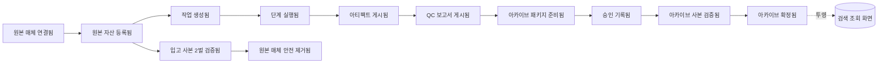
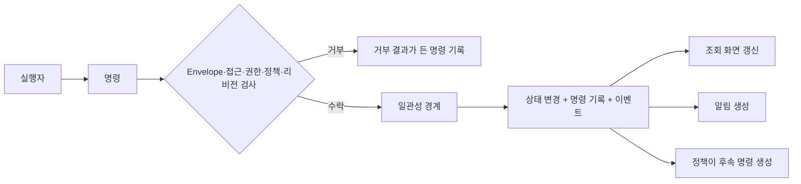

# 08. 이벤트 스토밍

## 1. 목적과 범위

이 문서는 [`ontology/terms.json`](../../ontology/terms.json)의 결정된 용어로 시스템의 업무 흐름을 시간순으로 펼친 결과다. 구현 구조를 먼저 정하지 않고 다음을 찾는 데 목적이 있다.

1. 담당자, 에이전트, Worker와 시스템 정책이 어떤 명령을 만드는가
2. 명령이 성공했을 때 어떤 상태 변경 사실을 이벤트로 남기는가
3. 이벤트 뒤에 어떤 정책과 다음 명령이 이어지는가
4. 한 원자 단위로 지켜야 하는 불변식의 소유자가 무엇인가
5. 요구사항을 쓰기 전에 결정해야 할 핫스팟이 무엇인가

여기서 이벤트는 저장되는 도메인 상태 변경 기록만 뜻한다. 진행률, CPU 사용률, 로그와 SSE 메시지는 각각 증적과 알림이며 이벤트가 아니다. 표의 명령·이벤트 이름은 설계 후보이고, 카탈로그에 요구사항으로 등록되어 구현되기 전까지 공개 계약은 아니다.

## 2. 표기

| 표기 | 의미 | 저장 여부 |
|---|---|---|
| 실행자 | 명령을 시작하는 Actor | 명령 기록에 포함 |
| 명령 | 상태 변경 의도 | 명령 자체 대신 처리 시도와 결과를 명령 기록으로 저장 |
| 일관성 경계 후보 | 명령을 판단하고 불변식을 지킬 책임 후보 | 구현 결정 전 후보 |
| 이벤트 | 이미 일어난 상태 변경 사실 | 추가 전용 저장 |
| 정책 | 이벤트를 보고 다음 명령을 결정하는 규칙 | 정책 정의와 실행 결과를 분리 |
| 조회 화면 | 이벤트와 현재 상태를 읽기 좋게 투영한 결과 | 다시 만들 수 있음 |
| 외부 실행 | FFmpeg, 파일시스템, OS 장치 API, Provider API 호출 | DB transaction 밖에서 수행 |
| 핫스팟 | 추가 결정이나 실험이 필요한 지점 | §12에서 관리 |

이벤트 이름은 과거형, 명령 이름은 동사형으로 쓴다. 거부된 명령은 명령 기록에는 남지만 상태가 바뀌지 않았으므로 이벤트를 만들지 않는다.

## 3. 큰 흐름



행사 기록, VJ 통합, 최종 편집본은 원본 자산 이후 서로 다른 템플릿으로 작업을 만들지만, 단계 실행과 아카이브 확정은 같은 공통 흐름을 사용한다.

## 4. 모든 상태 변경에 공통인 흐름



공통 불변식은 다음과 같다.

- Handler보다 먼저 접근·권한·정책을 판정한다.
- 모든 명령 시도는 수락과 거부를 포함해 명령 기록으로 남긴다.
- 수락된 명령의 상태 변경, 명령 기록, 이벤트는 같은 DB transaction에 기록한다.
- 이벤트는 원인이 된 명령 기록을 `command_id`로 참조한다.
- 정책이 자동으로 만든 명령은 ActorType.SYSTEM 실행자를 가진다.
- 같은 idempotency key의 재전송은 현재 리비전보다 저장된 명령 결과를 먼저 확인한다.
- Worker 결과는 현재 실행 리스의 펜싱 토큰과 일치할 때만 받는다.
- 파일시스템과 subprocess는 DB transaction에 포함할 수 없으므로 임시 출력 → 검증 → 게시 명령 순서로 연결한다.

## 5. 원본 매체 입고

| 순서 | 실행자·계기 | 명령 | 일관성 경계 후보 | 이벤트 | 정책·다음 동작 |
|---:|---|---|---|---|---|
| 1 | Worker의 장치 어댑터 | `ReportPhysicalDeviceConnected` | PhysicalDevice | `PhysicalDeviceConnected` | 허용된 장치이면 볼륨 조사를 요청 |
| 2 | 시스템 정책 | `InspectVolume` | Volume | `VolumeInspected` | 파일시스템과 장치 식별이 유효하면 원본 매체로 등록 가능 |
| 3 | 담당자 | `RegisterSourceMedia` | SourceMedia·Storage | `SourceMediaRegistered` | 등록된 storage_id만 후속 명령에 사용 |
| 4 | 담당자 또는 시스템 | `RegisterOriginalAssets` | OriginalAsset | `OriginalAssetRegistered` | 파일별 최초 체크섬과 표시용 원래 이름을 고정 |
| 5 | 시스템 정책 | `CreateAndVerifyIntakeCopy` | IntakeCopy | `IntakeCopyVerified` | 첫 사본과 두 번째 사본을 서로 다른 물리 장치에 배치 |
| 6 | 시스템 정책 | `WaitForSourceMediaReturnApproval` | Step | `StepWaiting(APPROVAL)` | 두 입고 사본이 모두 검증된 경우에만 승인 Action Card 표시 |
| 7 | 담당자 | `RecordApproval` | Approval | `ApprovalRecorded` | 승인 대상 리비전이 현재 값과 같을 때만 유효 |
| 8 | 담당자 | `RequestSafeEject` | Volume | `VolumeEjectPending` | 활성 lock이 없으면 장치 어댑터에 제거 요청 |
| 9 | Worker의 장치 어댑터 | `ReportVolumeEjected` | Volume | `VolumeEjected` | 원본 매체 입고 작업 완료 |

핵심 예외 흐름:

- 체크섬 불일치: 입고 사본을 등록하지 않고 해당 Step을 실패 또는 입력 대기로 전환한다.
- 장치 분리: 시도 횟수를 소비하지 않고 WaitReason.DEVICE로 기다린다.
- 같은 내용의 원본 자산: 자동 덮어쓰지 않고 중복 후보를 조회 화면에 표시한다.
- 안전 제거 승인 후 대상 리비전이 바뀜: 기존 승인은 유효하지 않으며 새 승인을 기다린다.

연결 요구사항: `PIP-004`, `ARC-001`, `DEV-001~003`, `WFL-006`.

## 6. 작업과 단계 실행

| 순서 | 실행자·계기 | 명령 | 일관성 경계 후보 | 이벤트 | 정책·다음 동작 |
|---:|---|---|---|---|---|
| 1 | 담당자 또는 정책 범위의 에이전트 | `CreateJob` | Job | `JobCreated`, `StepQueued` | Template의 StepDefinition을 실행 Step으로 고정 |
| 2 | Step이 QUEUED가 됨 | `EvaluateStepStart` | Step | `StepWaiting` 또는 `StepReserved` | Wait Reason 또는 Worker 선택으로 분기 |
| 3 | 자원 예약 완료 | `GrantExecutionLease` | Step·ExecutionLease | `ExecutionLeaseGranted` | Worker에 실행 계획 전달 |
| 4 | Worker | `StartStep` | Step | `StepStarted` | 실행 리스 heartbeat 시작 |
| 5 | Worker | `BeginStepVerification` | Step | `StepVerificationStarted` | 임시 출력만 검사하며 아직 아티팩트로 등록하지 않음 |
| 6 | Worker | `PublishArtifact` | Artifact | `ArtifactPublished` | 현재 펜싱 토큰, checksum, provenance를 검증 |
| 7 | Worker | `CompleteStep` | Step | `StepCompleted` | 모든 선행 Step이 완료된 후속 Step을 QUEUED로 전환 |

대기와 실패 정책:

| 조건 | 명령 결과와 이벤트 | 시도 횟수 |
|---|---|---:|
| HostLoadState가 준비되지 않음 | `StepWaiting` + WaitReason.IDLE/MEMORY/SCRATCH/PRIORITY | 소비하지 않음 |
| slot 또는 물리 장치 충돌 | `StepWaiting` + WaitReason.SLOT/DISK | 소비하지 않음 |
| 승인·입력·장치 필요 | `StepWaiting` + WaitReason.APPROVAL/INPUT/DEVICE | 소비하지 않음 |
| 일시적 process/network 오류 | `StepRetryScheduled` | 소비함 |
| 손상 입력·지원하지 않는 codec | `StepFailed` | 즉시 종결 가능 |
| 검증 실패 | 임시 출력 폐기 후 `StepRetryScheduled` 또는 `StepFailed` | 정책에 따름 |

실행 리스 복구:

```text
ExecutionLeaseExpired
→ 저장된 명령 결과와 게시된 아티팩트 확인
→ 이미 게시됨: CompleteStep 재조정
→ 게시되지 않음: RequeueStep
→ 이전 펜싱 토큰의 늦은 결과: 명령 거부, 이벤트 없음
```

연결 요구사항: `WFL-001~011`, `RES-001~008`, `WRK-002~004`, `EXE-001~003`.

## 7. 행사 기록

| 순서 | 명령 | 결과 이벤트 | 다음 정책 |
|---:|---|---|---|
| 1 | `CreateJob(template=occasion-recording)` | `JobCreated` | intake 이후 inspect 단계 시작 |
| 2 | `InspectOriginalAsset` | `OriginalAssetInspected` | proxy, thumbnail, audio 추출 분기 |
| 3 | `Render(profile=proxy)` | `RenditionPublished` | QC 입력에 추가 |
| 4 | `CreateThumbnail` | `ArtifactPublished(THUMBNAIL)` | QC 입력에 추가 |
| 5 | `ExtractAudio` | `ArtifactPublished(AUDIO_EXTRACT)` | STT 시작 |
| 6 | `TranscribeAudio` | `ArtifactPublished(STT)` | 요약 시작 |
| 7 | `CreateSummary` | `ArtifactPublished(SUMMARY)` | 사람 검수 대상으로 표시 |
| 8 | `RecordContentReview` | `ContentReviewRecorded` | 검수 결과를 QC 입력에 포함 |
| 9 | `RunIntegratedQC` | `QCReportPublished` | 통과한 경우 아카이브 패키지 준비 |
| 10 | §10의 공통 아카이브 흐름 | `ArchiveCommitted` | 검색·아카이브 조회 화면 갱신 |

STT 원문은 요약으로 대체하지 않는다. 요약과 키워드는 STT 아티팩트를 입력으로 가진 별도 아티팩트이며, 사람이 한 검수는 실행 승인과 구분한다.

연결 요구사항: `PIP-001`, `ARC-002~007`.

## 8. VJ 통합

| 순서 | 명령 | 결과 이벤트 | 다음 정책 |
|---:|---|---|---|
| 1 | `CreateJob(template=vj-compilation)` | `JobCreated` | clip 조사 시작 |
| 2 | `InspectClips` | `ClipsInspected` | 사용할 cut 선택 가능 |
| 3 | `RecordCutSelection` | `CutSelectionRecorded` | Timeline 생성 |
| 4 | `CreateTimeline` | `TimelineCreated` | preview 렌더 |
| 5 | `Render(profile=preview)` | `RenditionPublished` | Timeline 승인 요청 |
| 6 | `RecordApproval(target=timeline revision)` | `ApprovalRecorded` | 일치하는 Timeline만 최종 렌더 가능 |
| 7 | `Render(profile=vj-archive)` | `RenditionPublished` | 통합 QC 수행 |
| 8 | `RunIntegratedQC` | `QCReportPublished` | 아카이브 패키지 준비 |
| 9 | `RecordApproval(target=archive package revision)` | `ApprovalRecorded` | preview 승인을 최종 결과 승인으로 재사용하지 않음 |
| 10 | §10의 복사·확정 흐름 | `ArchiveCommitted` | 검색 조회 화면 갱신 |

Timeline은 clip ID, in/out, 순서, cut marker를 가진다. Timeline 리비전이 바뀌면 preview 승인도 무효가 된다.

연결 요구사항: `PIP-002`, `WFL-006`, `ARC-004`.

## 9. 최종 편집본 입고와 납품 기록

| 순서 | 명령 | 결과 이벤트 | 다음 정책 |
|---:|---|---|---|
| 1 | `CheckOriginalAssetDuplicate` | 중복이면 명령 거부, 새 이벤트 없음 | 기존 원본 자산을 표시 |
| 2 | `RegisterOriginalAsset(edit_version)` | `OriginalAssetRegistered` | 편집본 버전과 외부 출처 기록 |
| 3 | `InspectOriginalAsset` | `OriginalAssetInspected` | 파생본 생성 |
| 4 | `Render(profile=proxy)` | `RenditionPublished` | QC 입력에 추가 |
| 5 | `CreateRepresentativeImage` | `ArtifactPublished(THUMBNAIL)` | QC 입력에 추가 |
| 6 | `RunIntegratedQC` | `QCReportPublished` | 납품 기록 가능 |
| 7 | `RecordDelivery` | `DeliveryRecorded` | 받는 곳, 시각, 편집본 버전 투영 |

최종 편집본도 외부에서 들어온 파일이므로 원본 자산이다. 파생 렌더 결과와 혼동하지 않는다.

연결 요구사항: `PIP-003`, `ARC-001~002`.

## 10. 공통 아카이브 흐름

| 순서 | 실행자·계기 | 명령 | 일관성 경계 후보 | 이벤트 | 불변식 |
|---:|---|---|---|---|---|
| 1 | QC 통과 | `StageArchivePackage` | ArchivePackage | `ArchivePackageStaged` | 필수 원본 자산·아티팩트·sidecar·manifest 포함 |
| 2 | 담당자 | `RecordApproval` | Approval | `ApprovalRecorded` | 패키지 리비전과 manifest digest를 승인 대상에 고정 |
| 3 | 시스템 정책 | `CreateAndVerifyArchiveCopy` | ArchiveCopy | `ArchiveCopyVerified` | storage_id와 checksum 검증 결과 기록 |
| 4 | 두 사본 검증됨 | `CommitArchive` | ArchivePackage | `ArchiveCommitted` | QC, 유효 승인, sidecar, manifest, 서로 다른 물리 장치의 두 사본 필요 |
| 5 | 확정 패키지 수정 필요 | `SupersedeArchivePackage` | ArchivePackage | `ArchivePackageSuperseded` | 기존 패키지를 덮어쓰지 않고 새 패키지를 생성 |

아카이브 사본 생성은 하나의 숨겨진 `archive` 실행으로 묶지 않는다. 주본과 복제본의 생성·검증을 각각 관찰하고 실패한 사본만 재시도할 수 있어야 한다.

연결 요구사항: `ARC-003~007`, `SEC-003`, `PER-001`.

## 11. 사람 개입, 에이전트와 파괴적 명령

### 11.1 제어 모드 변경

| 실행자 | 명령 | 이벤트 | 불변식 |
|---|---|---|---|
| 담당자 | `ChangeControlMode(MANUAL)` | `ControlModeChanged` | 실행 리스와 StepState를 바꾸지 않음 |
| 담당자 | 도메인별 수동 명령 | 해당 도메인 이벤트 | 에이전트와 같은 Command Bus 사용 |
| 담당자 | `ChangeControlMode(ASSISTED/AGENT)` | `ControlModeChanged` | 최신 이벤트와 현재 상태를 다시 읽은 뒤 에이전트가 계획 |

### 11.2 에이전트와 Provider 폴백

```text
사용자 질문
→ 에이전트 게이트웨이가 Provider 계정 선택
→ 에이전트가 조회하거나 명령 제안
→ 승인·자동화 정책이 허용하면 ActorType.AGENT 명령 제출
→ 명령 기록과 이벤트는 사람 명령과 동일하게 처리
```

Provider 실패가 계정 상태를 바꾸면 `ProviderAccountCooldownStarted`, `ProviderAccountQuotaExhausted`, `ProviderAccountAuthenticationFailed` 같은 이벤트 후보를 남긴다. 다음 계정으로 폴백하기 전 완료된 Tool Call과 실제 Job 상태를 읽고, 완료된 명령은 다시 실행하지 않는다. 모든 계정이 제외되면 AI 사용 불가 상태가 되지만 버튼·폼을 통한 도메인 명령은 계속 사용할 수 있다.

연결 요구사항: `AGT-002~013`, `SEC-002`.

### 11.3 볼륨 포맷

```text
RecordApproval(target=Volume revision)
→ ConfirmFormatTarget(expected label = typed label)
→ FormatVolume
→ VolumeFormatStarted
→ 장치 어댑터 외부 실행
→ VolumeFormatted 또는 VolumeFormatFailed
```

`FormatVolume`은 시스템 볼륨이 아니고, 활성 lock이 없고, 보존 대상 데이터의 필요한 사본과 checksum이 확인됐으며, boot 정책이 허용하고, 유효한 승인과 재확인이 있을 때만 수락한다. 누가 승인할 수 있는지는 권한 정책이 정하며 장치 도메인이 관리자 여부를 직접 판단하지 않는다.

연결 요구사항: `DEV-004~005`, `SEC-001`, `CFG-004~005`.

## 12. 일관성 경계 후보

이 표는 코드 구조의 확정안이 아니라 이벤트 스토밍에서 발견한 원자성 소유 후보다.

| 후보 | 한 원자 단위로 지킬 것 | 경계 밖에 둘 것 |
|---|---|---|
| Template | StepDefinition ID 유일성, 의존성 존재, 순환 없음 | 실행 상태 |
| Job | Template snapshot과 대상 참조, Step 생성의 완전성 | 개별 Step 실행 상태의 장기 잠금 |
| Step | StepState, Wait Reason, 시도 횟수, 제어 모드, 실행 리스, 펜싱 토큰, 리비전 | subprocess와 파일 내용 |
| OriginalAsset | 최초 checksum과 원래 이름의 불변성 | 파생 아티팩트 생애주기 |
| Artifact | provenance 완전성, 검증 후 한 번만 게시 | 임시 출력 |
| Approval | 승인자, 대상, 대상 리비전, 결정, 사유, 근거의 추가 전용 기록 | 대상 자체의 상태 |
| ArchivePackage | 구성 manifest, QC·승인·사본 증적, 확정과 대체 불변식 | 각 저장소의 파일 복사 실행 |
| Volume | mount 상태, lock, eject pending, format 진행 상태 | 업무 메타데이터 해석 |
| Worker | 연결·heartbeat·수락 상태와 보고한 자원 | Step의 업무 상태 |
| Provider 계정 | 상태, cooldown, budget, 기능·데이터 정책 | Job과 Step 상태 |

CommandRecord는 감사와 멱등성의 영속 기록이지만 업무 Aggregate 후보로 보지 않는다. 모든 일관성 경계 앞에 놓이는 애플리케이션 계층 계약이다.

## 13. 조회 화면 후보

| 조회 화면 | 입력 | 용도 |
|---|---|---|
| 작업함 | Job, StepState, Wait Reason, 실행 우선순위 | 대기·실행·실패 작업 확인 |
| 작업 상세 타임라인 | 명령 기록, 이벤트, Approval, Tool Call, process log 위치 | 사람이 중간 개입하고 실패 원인을 확인 |
| 자산 검색 | OriginalAsset, Artifact, 기술정보, STT·요약 텍스트 | 제목·행사·내용·codec·시간 검색 |
| 아카이브 상태 | ArchivePackage, ArchiveCopy, manifest 재검증 결과 | 주본·복제본 상태와 복구 필요 여부 확인 |
| 장치·저장소 | PhysicalDevice, Volume, Storage, lock | 안전 제거·포맷 전 확인 |
| Worker 상태 | heartbeat, HostLoadState, slot, 접근 Storage | 배정 가능 여부와 자원 병목 확인 |
| AI 계정 상태 | 계정 상태, cooldown, budget, 최근 실패 | 폴백 순서와 AI 사용 불가 원인 확인 |

이 조회 화면은 원본 업무 기록이 아니다. SQLite를 잃었을 때 sidecar와 이벤트로 재구축하거나 필요하면 다시 투영할 수 있어야 한다.

## 14. 핫스팟과 권장 결정

| ID | 핫스팟 | 권장안 | 현재 상태 |
|---|---|---|---|
| ES-01 | 아카이브 승인의 정확한 대상 | staged ArchivePackage의 리비전과 manifest digest를 승인 | `ARC-004`로 고정 |
| ES-02 | Review 결과의 식별자·상태·리비전이 용어집에 없음 | 변경 불가능한 ContentReview 기록과 검수 상태 정의 | `content-review` 용어와 `PIP-006`으로 고정 |
| ES-03 | Timeline과 cut 선택이 용어집에 없음 | Timeline Entity와 CutSelection Value 정의 | 결정 필요 |
| ES-04 | STT·요약·기술정보를 모두 일반 Artifact로만 표현할지 | 검색과 검수 규칙이 다르므로 Transcript, Summary, MediaInspection을 Artifact의 종류로 정의 | 결정 필요 |
| ES-05 | SourceMedia와 PhysicalDevice의 식별자가 중복될 가능성 | SourceMedia를 독립 ID가 아니라 SOURCE_MEDIA Storage를 가진 PhysicalDevice의 문맥상 역할로 정리 | 온톨로지 `source-media-identity` open에 기록 |
| ES-06 | Job 자체 상태가 필요한지 | 초기에는 Step 투영으로 계산하고 별도 JobState를 만들지 않음 | `job` 규칙으로 고정 |
| ES-07 | 저장하지 않는 Notification의 reconnect cursor | 이벤트 기반 알림은 event ID로 재생하고 metric 알림은 재생하지 않음 | `NTF-001`, `NTF-002`로 고정 |
| ES-08 | DB와 파일 publish 사이 장애 | staging ID와 publish receipt를 두고 재시작 시 파일과 DB를 조정 | `WFL-009`, `EXE-002`, 계획 `EXE-003` |
| ES-09 | Provider 계정·요청·Tool Call 용어가 없음 | Agent Gateway 이벤트를 확정하기 전에 세 용어와 상태 집합 정의 | 결정 필요 |
| ES-10 | 모든 이벤트가 command_id를 요구함 | heartbeat timeout, 장치 감지, 정책 실행도 ActorType.SYSTEM 명령을 먼저 기록 | `CMD-007`, `CMD-008`로 공통 계약 고정 |
| ES-11 | 실패 이벤트 이름이 오류 종류마다 폭증할 수 있음 | 상태 이벤트는 StepWaiting/RetryScheduled/Failed로 제한하고 error_class를 payload로 기록 | `WFL-010`으로 분류 규칙 고정 |
| ES-12 | ArchivePackage import가 과거 Event를 중복 생성할 위험 | import는 원래 ID의 기록을 idempotent하게 복원하고 별도 Import 결과만 현재 명령 기록에 남김 | 계획 `ARC-007`에 포함 |
| ES-13 | Volume, Worker, Provider 계정의 생애주기 상태 집합이 없음 | 이벤트 이름을 확정하기 전에 각 상태 집합과 허용 전이를 정의 | 결정 필요 |

## 15. 요구사항으로 내리는 순서

1. 아직 열린 ES-02~05, ES-09, ES-13의 용어와 상태 집합을 결정한다.
2. 계획 상태인 `PER-001`로 SQLite의 상태·명령 기록·이벤트 원자성을 통합 테스트한다.
3. 원본 매체 입고를 첫 Adapter 수직 슬라이스로 연결한다.
4. `ARC-007`과 `EXE-003`으로 sidecar import 및 파일 게시 장애 조정을 검증한다.
5. 행사 기록, VJ 통합, 최종 편집본 Template을 실제 FFmpeg·STT Adapter에 연결한다.
6. `NTF-002`로 Dashboard 재연결을 검증한다.
7. Agent Gateway는 수동 흐름이 완결된 뒤 같은 Command Bus를 호출하도록 연결한다.

각 명령은 정상 흐름 하나와 독립된 거부 이유 하나가 관찰되도록 요구사항을 나눈다. 이벤트 이름만 확인하지 않고 상태, 명령 기록, 이벤트가 같은 transaction으로 보이는지 검증한다.
