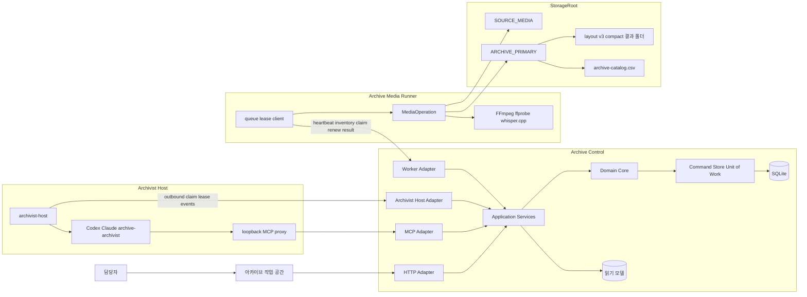
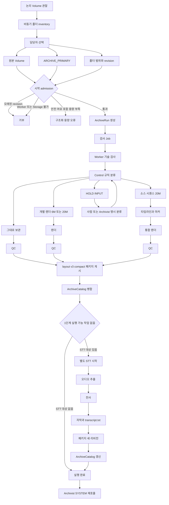
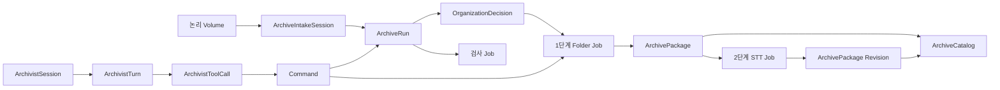

# 15. 현재 구현 기준선

검증 기준선 갱신일: 2026-11-23

이 문서는 설계 목표, 실제 운영 진입점, 현재 연결된 기능과 planned 경계를 한 곳에서 대조한다. 상세 규칙은 각 소유 설계와 `requirements/catalog.json`이 우선하며, 이 문서는 현재 상태를 찾는 인덱스다.

## 1. 검증 기준선

- 요구사항 336개 중 implemented 294개, planned 42개
- implemented 요구사항과 주석 테스트 294개가 1:1 연결
- `make verify`, `go vet ./...` 통과를 변경 인계 조건으로 사용
- Core는 Application·Adapter와 HTTP·SQLite·FFmpeg·Windows API를 import하지 않음
- 실제 제품 수직 경로는 Archive Intake와 별도 STT, layout v3 compact 게시·카탈로그 대조까지 연결
- 일반 Template Job은 영속 생성·목록·상세·취소까지만 연결되고 실제 Worker 실행 명세 조립은 연결되지 않음

## 2. 컨테이너와 의존 방향

정상 의존은 `Adapter → Application → Core`다. 현재 Core 경계는 이 방향을 지킨다. 현재 구조 예외는 다음 Application 패키지가 구체 Adapter를 직접 참조하는 것이다.

- `archiveorganization → mediafolder`
- `workerexecutor → archivebundle, archivecatalog, ffmpeg, ffprobe, mediafolder, subtitlefile, transcripttext, whispercpp, workerconfig`
- `workerclient → workerconfig`
- `archivisthostclient → archivisthostconfig`

실행에는 문제가 없지만 Port와 구체 구현의 조립 위치가 목표 계층과 다르다. Worker 실행 Port를 유지하면서 구체 조립을 `cmd` 또는 Adapter 쪽으로 옮기는 것이 후속 구조 정리다.

## 3. Archive Intake 기능 흐름

### 시작 경계

- 담당자가 원본·아카이브 저장소·폴더 범위를 고정한다.
- Worker는 원본과 아카이브 Storage에 모두 접근 가능해야 한다.
- 선택 범위의 탐색 revision이 현재 inventory와 같아야 한다.
- 예상 출력에 5%와 64 MiB 중 큰 안전 여유를 더해 현재 여유와 비교한다. `ARC-019`
- ArchiveRun 전체 기간의 Storage 쓰기·용량 예약은 `ARC-010` planned다. 패키지와 Catalog의 파일 잠금은 게시 경합을 막지만 용량을 미리 점유하지 않는다.

### 분류와 HOLD

- 자동 분류는 기술 관찰값과 versioned policy만 사용한다.
- HOLD는 외부 Step을 만들지 않고 `WAITING/INPUT`으로 투영한다.
- HOLD는 Control 원장과 작업 공간에 남고 layout v3 루트 Catalog 행은 만들지 않는다.
- 사람 또는 Archivist가 실행 ID·최신 revision·근거를 붙여 명시적으로 분류하면 같은 ArchiveRun에 Folder Job을 한 번 연결한다.

### 보관과 기록

- Production Worker의 새 게시 기본값은 layout v3 compact다. 기존 layout v1·v2는 읽기·복구 호환을 유지한다.
- Archive Storage root 바로 아래 결과 폴더 한 단계만 둔다.
- 결과 폴더에는 영상 정확히 하나·video-info.csv와 선택적인 transcript.txt·subtitle.srt만 공개하고 복구 정보는 `.archive-package.json`에 둔다.
- root `archive-catalog.csv`는 ArchivePackage 하나당 한 행이다.
- 폴더 `video-info.csv`는 OriginalAsset 하나당 한 행이다.
- `verify`와 `rebuild`는 `결과 폴더 1 = Package 1 = 결과 영상 1 = root CSV 행 1`을 대조한다.

## 4. 영속 객체와 상태 소유권

| 객체 | 소유하는 값 | 소유하지 않는 값 |
|---|---|---|
| ArchiveRun | Worker, 원본·아카이브 Storage, 고정 폴더 scope, 사람 선택, 단계 소유권 | 현재 진행 상태, 완료율, Step lease |
| OrganizationDecision | 실행·폴더별 판정 sequence, 행위자, 근거, 입력 revision | Worker 실행 상태 |
| Job | Template snapshot, Step DAG, StepState, WaitReason, lease, 실행 명세·출력 기록 | ArchiveRun 전체 선택 범위 |
| ArchivePackage | 결과 영상, provenance, sidecar, manifest, revision, 보관 상태 | Control의 queue 상태 |
| ArchiveCatalog | Archive Storage의 현재 검색·추적 투영 | package 전 HOLD·처리 중 상태 |
| ArchivistSession·Turn | 대화 identity, Host·CLI, lease·fencing, 정제된 항목 | Worker subprocess와 미디어 파일 경로 |

ArchiveRun은 영속 업무 identity와 선택 일관성 경계다. 현재 1·2단계 진행 상태는 최신 OrganizationDecision과 소유 Job을 읽어 계산한다. 명령의 STT 게이트는 Core 규칙을 사용하지만 화면의 실행 상태는 별도 요약 함수로 계산하므로 후속 단일화가 필요하다.

## 5. 현재 기능 목록

| 영역 | 기능 | 상태 |
|---|---|---|
| 작업 관리 | ArchiveRun·독립 Job 목록, 진행 중·대기·확인 필요·완료, 영속 상세 | 연결됨 |
| 작업 생성 | 원본·아카이브·폴더 범위로 ArchiveRun 생성 | 연결됨 |
| 일반 Template 생성 | 행사 기록·VJ·최종 편집·대용량 입고 Job 영속 생성 | 일부: 실행 builder 없음 |
| 드라이브 | Windows 논리 Volume 연결·분리, 역할별 Storage identity, 점진 inventory | 연결됨, 일부 실장비 acceptance planned |
| Worker | 자원 관측, 수용 판정, queue, reservation, lease 갱신, 취소·결과 정산 | 연결됨 |
| 1단계 | 검사, 분류, 렌더, 시퀀스, QC, 패키지, Catalog | 연결됨 |
| 2단계 | 오디오, STT, SRT, transcript.txt, 패키지 리비전, Catalog | 연결됨, 실제 한국어 모델 품질 planned |
| 기록 형식 | layout v3 compact 결과 폴더, root Catalog, video-info, verify·rebuild | 연결됨 |
| 검색 | 자료·전사문 검색, 기록물 상세·요약 조회 | 화면 연결됨 |
| Archivist | Session·Turn·Tool Call·ActionCard·SYSTEM 재호출 | fixture 수직 연결, 실제 계정 acceptance 일부 planned |
| MCP | Job 조회·생성, 자료 검색, 선택 조회, ArchiveRun 상태·시작·STT, HOLD 목록·상세·분류 | 연결됨 |
| 단독 CLI | inspect, render, sequence, QC, package, audio, transcribe, subtitle, transcript-text, package revision, Catalog publish·verify·rebuild | 연결됨 |
| 아카이브 확정 | 복제본 검증·Approval·COMMITTED | `ARC-012` planned |
| 패키지 복원 | ArchivePackage만으로 빈 DB 복원 | `ARC-007` planned |
| 네트워크·원격 Storage | SMB·FTP·SFTP identity, credential, 안전 게시 | `CFG-012~013`, `DEV-012` planned |
| 공통 Capability Registry | 모든 영속 업무의 Adapter 없는 직접 실행 | `APP-001` planned |
| 미디어 실행 모니터링 | Worker·CLI 공통 단계 진입, FFmpeg 출력 위치, 전사 입력·청크·엔진 진행, 관리형 보고 누락과 완료 후속 반영 | [실행 증적 경계](10-capabilities-observability.md#3-실행-증적-경계) |
| 공통 운영 증적 | 모든 업무 실행의 Evidence Sink | `OBS-001` planned |
| 장치 정리 | 안전 해제·포맷·원본 삭제 | planned 또는 요구사항 미확정 |

## 6. Archivist 도구 경계

현재 MCP allowlist는 다음 기능을 제공한다.

- Job 조회·생성
- 자료 검색
- Turn에 고정된 드라이브 선택 조회
- ArchiveRun 상태 조회·시작
- 2단계 STT 시작
- 현재 HOLD 목록·단일 상세·명시 분류

Archivist는 메시지 본문에서 원본·아카이브 Storage·폴더 범위를 추론하지 않는다. 현재 선택 참조가 없으면 선택 필요 ActionCard를 만들고 사람이 작업 공간에서 고른다. 전체 Worker·드라이브·Storage 후보를 Archivist가 직접 선택하도록 바꾸려면 단순 조회 도구 추가만으로 충분하지 않으며 선택 권한·감사·최신 revision 계약을 함께 변경해야 한다.

## 7. 현재까지 완료한 묶음

1. Command·Event·receipt Unit of Work와 SQLite 공유 연결
2. Workflow 전이, retry 분류, Approval, ExecutionLease·fencing
3. Worker heartbeat·bounded inventory·자원 admission·예약·임대 갱신·취소 정산
4. 논리 Volume 자동 관찰과 source/archive 역할 분리
5. ArchiveRun 고정 범위, 검사 결과 outbox 조정, 규칙 분류와 HOLD 재개
6. 1단계 렌더·QC·보관과 2단계 STT 분리
7. layout v3 compact 결과 폴더, Package revision, root Catalog와 video-info 대조·재생성
8. 작업 관리·드라이브·연결 관리·검색·Archivist 대화 화면과 golden 회귀
9. Archivist Host, Codex app-server Adapter, ChatGPT·local model loop, MCP·ActionCard·재호출 계약
10. `archive-media` 단독 CLI와 선택형 관리 Runner의 공통 MediaOperation

## 8. 현재 불일치와 후속 순서

| 우선순위 | 불일치 | 정리 방향 |
|---|---|---|
| 1 | 화면에서 일반 Template Job을 만들 수 있지만 실제 Worker 실행 명세가 없음 | 실제 builder를 구현하거나 v1 화면에서 생성 조작을 내림 |
| 2 | STT 명령 게이트와 화면 ArchiveRun 상태가 같은 업무 규칙을 별도로 계산 | Core의 ArchiveRunProgress 결과를 공통 읽기 모델로 사용 |
| 3 | ArchiveRun 시작 전 용량 검사는 있지만 실행 기간 Storage 예약이 없음 | `ARC-010` 구현, 시작·종료·취소에 예약 생애주기 연결 |
| 4 | Application에서 구체 media·config Adapter를 직접 import | Port는 Application에, 조립은 `cmd`·Adapter에 이동 |
| 5 | 공통 Capability Registry가 프로토타입이고 운영 미연결 | 필요성을 재결정한 뒤 연결 전까지 `APP-001` planned 유지 |
| 6 | Production 진입점에서 도달하지 않는 구형·후속 패키지 | 대체 여부를 확인하고 삭제 또는 planned 모듈로 명시 |
| 7 | 확정·복원·네트워크 Storage·실계정 Archivist acceptance | 현재 planned 요구사항 순서대로 수직 검증 |

현재 기준선에서는 Archive Intake 수직 경로를 우선 보존한다. 구조 정리는 공개 Command·StepExecutionSpec·ArchivePackage 형식을 바꾸지 않는 작은 변경으로 나누며, 요구사항 의미가 바뀌면 설계·카탈로그·semantic lock·단일 테스트를 한 묶음으로 갱신한다.
