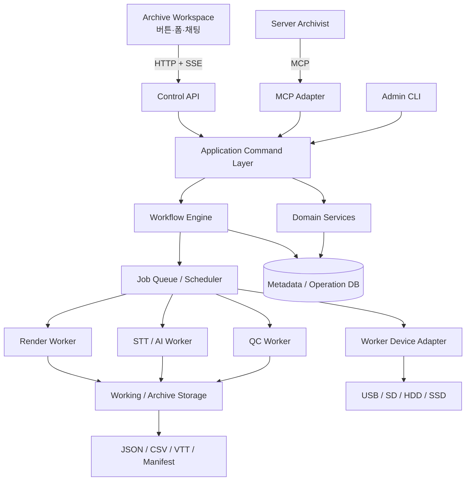
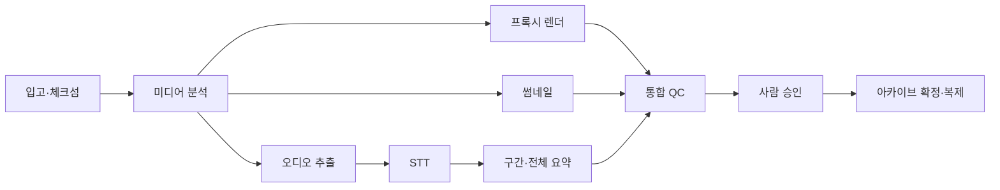

# 영상 제작 기록 자동화 시스템 설계안

- 문서 상태: 초기 설계안
- 작성일: 2026-10-05
- 대상: 사무실 영상 입고, 처리, 기록, 검색, 외장 미디어 및 아카이브 운영
- 구현 단계: Core와 일부 Adapter 계약 기준선 구현, 전체 운영 기능은 설계·구현 중

## 1. 목적

촬영 원본을 안전하게 입고하고, 영상 유형에 맞게 렌더링·전사·요약·병합한 뒤, 결과와 처리 이력을 검색 가능한 형태로 기록한다. Archivist가 자동으로 대용량 파일 Job을 계획하고 실행할 수 있어야 하며, 사람이 아카이브 작업 공간에서 업무 현황과 증적을 확인하고 중간에 개입하거나 Archivist 없이 같은 도메인 기능을 직접 실행할 수 있어야 한다.

최종적으로 다음을 달성한다.

1. 원본과 파생본을 구분해 안전하게 보존한다.
2. 행사 녹화, VJ 소스, 최종 편집본 등 영상 유형별 워크플로를 제공한다.
3. 영상 설명, 기술정보, STT, 요약, 체크섬, 보관 위치를 함께 기록한다.
4. DB를 이용해 빠르게 검색하되 DB가 없어도 아카이브 내용을 해석하고 목록을 복구할 수 있게 한다.
5. MCP, HTTP API, 아카이브 작업 공간, CLI가 동일한 도메인 기능을 사용한다.
6. USB, SSD, HDD 같은 PhysicalDevice를 작업 공간 단위로 삼아 입고·복사·검증·안전 해제·포맷을 통제한다.
7. Archivist 장애나 AI 미사용 상황에서도 사람이 운영을 계속할 수 있게 한다.

## 2. 핵심 설계 원칙

### 2.1 도메인 우선

업무 기능을 MCP 도구나 API 엔드포인트에 직접 구현하지 않는다. 도메인과 애플리케이션 기능을 먼저 만들고 MCP, HTTP, CLI를 어댑터로 둔다.

```text
MCP Adapter ─┐
HTTP Adapter ├─ Application Command Layer ─ Domain Services
CLI Adapter ─┘
```

### 2.2 워크플로 엔진이 상태를 소유

Archivist는 조사, 분류, 계획, 오류 분석을 담당한다. 전체 작업 상태, 선행 조건, 재시도, 병렬 실행, 승인 대기는 워크플로 엔진이 영속적으로 관리한다. Archivist가 종료되거나 교체되어도 진행 중인 작업은 유실되지 않아야 한다.

### 2.3 원본은 불변

원본 파일은 입고 후 변경하지 않는다. 병합본, 프록시, STT, 자막, 요약, 썸네일과 아카이브 렌더본은 모두 출처가 기록된 파생 아티팩트로 취급한다.

### 2.4 DB와 파일 기록의 이중 안전성

- DB: 현재 상태, 관계, 검색, 승인, CommandRecord와 Event의 기준
- 파일형 사이드카: 아카이브 패키지를 독립적으로 해석하고 DB를 재구축하기 위한 기록
- 영상 데이터: DB BLOB이 아니라 파일시스템, NAS, 외장 하드에 저장

### 2.5 사람 우선 폴백

표준 Template 실행과 즉시 실행은 Archivist가 없어도 동작해야 한다. 채팅은 편의를 제공하지만 필수 운영 인터페이스가 아니다.

### 2.6 파괴적 작업은 자동화하지 않음

포맷, 원본 삭제, 기존 아카이브 대체와 같은 작업은 Archivist가 제안할 수 있지만 사람의 명시적 승인 없이 실행하지 않는다.

## 3. 전체 아키텍처



### 3.1 Control Plane

- 사용자, 역할, 승인 관리
- 작업 생성과 상태 전이
- Archivist 계획과 사람 피드백
- 도메인 명령 검증
- CommandRecord와 Event
- 장치 및 아카이브 인벤토리

### 3.2 Execution Plane

- FFmpeg 렌더링
- 오디오 추출 및 STT
- 요약과 키워드 추출
- VJ 타임라인 및 미리보기 생성
- 썸네일과 콘택트시트 생성
- 무결성 및 QC 검사

### 3.3 Storage Plane

- 입고 원본
- 작업 임시공간
- 프록시 및 파생 아티팩트
- 아카이브 주본과 복제본
- 메타데이터 사이드카
- 중앙 DB와 검색 인덱스

### 3.4 초기 물리 배치: 32GB All-in-One

Control Plane과 Execution Plane은 코드와 프로세스 경계에서는 분리하지만 초기 운영에서는 하나의 32GB Windows PC에 함께 배치한다.

```text
32GB Windows PC
├── Archive Control
│   ├── Archive Workspace / API
│   ├── MCP Adapter
│   ├── Workflow Scheduler
│   └── SQLite / Search
└── Archive Worker
    ├── Worker Device Adapter
    ├── FFmpeg
    ├── STT
    ├── VJ / QC
    └── Archive Copy
```

두 역할을 별도 프로세스로 유지해 미디어 작업의 오류가 Archive Control를 함께 종료하지 않게 한다. 향후 PC를 추가할 때 Archive Worker만 다른 장비로 이동하거나 추가할 수 있어야 한다.

### 3.5 다중 Worker PC

Worker PC가 추가되면 Archive Control와 SQLite는 중앙 PC에 유지하고 `Archive Worker`만 여러 PC에 설치한다.

```text
Archive Control + SQLite
    ↑ outbound connect / heartbeat / lease / result
    ├── worker-main       같은 PC의 기본 Worker
    ├── worker-render-01  렌더 전용 Worker PC
    └── worker-ingest-01  외장 장치 입고 PC
```

Worker는 DB 파일을 직접 열지 않는다. 각 Worker는 설정 파일에 사전 등록된 `worker_id`, 개별 service credential reference, 처리 종류, 접근 가능한 storage ID를 갖는다. Archive Workspace 사용자 인증을 끄더라도 Worker service 인증은 끄지 않는다. Worker가 Control로 outbound 연결하므로 Worker PC에 inbound 포트를 열지 않는다.

Scheduler는 heartbeat가 유효하고 필요한 처리 종류와 Storage 접근성을 가진 Worker에만 Step lease를 발급한다. USB·SD·HDD가 특정 Worker에 연결된 경우 해당 물리 매체를 사용하는 단계는 그 Worker에 고정한다. 다른 Worker로 이어서 처리하려면 shared Storage 게시 또는 명시적인 transfer 단계가 선행되어야 한다.

## 4. 도메인 경계

| 도메인 | 책임 | 소유하는 주요 결과 |
|---|---|---|
| Intake | 파일 입고, 복사 세션, 체크섬, 중복 조사 | `OriginalAsset`, `CopySession` |
| Media Analysis | 코덱, 길이, 프레임레이트, 오디오, 타임코드 분석 | `MediaInspection` |
| Transcription | 오디오 추출, STT, 자막 | `Transcript`, `Subtitle` |
| Content Intelligence | 요약, 키워드, 챕터, 인물 언급 | `Summary` |
| VJ Assembly | 클립 선택, 순서, 인·아웃, 컷 마커 | `Timeline` |
| Rendering | 입력과 프로파일을 이용한 영상 출력 | `Rendition` |
| Quality Control | 재생, 길이, 싱크, 손상, 무음·블랙 검사 | `QCReport` |
| Catalog | 제목, 설명, 프로젝트, 인물, 권리, 분류 | `CatalogRecord` |
| Archive | 패키지 생성, 복제, 검증, 보존 확정 | `ArchivePackage` |
| Device Management | 물리 장치, 파티션, 볼륨, 마운트, 배출, 포맷 | `PhysicalDevice`, `Volume` |
| Storage Inventory | 저장 매체 역할, 물리 위치, 용량, 수명주기 | `Storage` |
| Workflow | 단계 의존성, 병렬 실행, 재시도, 승인 | `Job`, `Step` |
| Search | 메타데이터·전사문·구간 색인 | 검색 인덱스 |

### 4.1 합성과 렌더링 분리

VJ 도메인은 영상을 직접 최종 렌더링하지 않는다. 다음과 같은 타임라인을 생성하고 Rendering 도메인이 이를 소비한다.

```text
VJ 클립 → VJ Assembly → Timeline → 사람/Archivist 검수
                                    ↓
                              Rendering → Rendition
```

행사 기록 렌더링과 VJ 렌더링은 업무 의도는 다르지만 동일한 렌더 엔진을 공유한다.

```text
OriginalAsset + archive-event-1080p profile → Rendering
Timeline   + vj-compilation-4k profile   → Rendering
```

### 4.2 STT와 요약 분리

```text
OriginalAsset → AudioArtifact → Transcript → Summary / Keywords / Chapters
```

STT는 인식 결과이고 요약은 AI 해석 결과다. 사람이 작성한 사실, AI 생성 내용, 사람이 검수한 내용을 별도 필드와 아티팩트로 관리한다.

## 5. 공통 도메인 모델

### 5.1 핵심 엔티티

- `OriginalAsset`: 입고되어 체크섬이 확정된 변경 불가능한 원본
- `Artifact`: 처리로 생성된 파일의 공통 개념
- `Timeline`: 클립 순서, 인·아웃, 마커, 전환 정보
- `Rendition`: 렌더링 결과와 프로파일
- `Transcript`: 시간 정보가 포함된 전사 결과
- `ArchivePackage`: 영상과 사이드카를 묶은 보존 단위
- `PhysicalDevice`: 실제 USB, SD 카드, HDD, SSD
- `WorkspaceDrive`: Job이 대용량 파일 I/O를 위해 예약한 PhysicalDevice의 역할
- `Volume`: 운영체제가 마운트한 파일시스템
- `Storage`: 볼륨 안의 등록 root와 업무 역할
- `Job`, `Step`: 전체 작업과 개별 실행 단계
- `Command`, `Event`, `Approval`: 조작, 상태변경, 승인 기록

### 5.2 아티팩트 출처 기록

모든 파생 결과에 다음을 기록한다.

- 원본 `asset_id`
- 입력 아티팩트 ID
- 처리 종류와 처리기 버전
- 렌더 또는 STT 프로파일 버전
- 생성 시각
- 실행자: 사람, Archivist, 시스템
- 파일 크기와 체크섬
- 검수 상태

## 6. 공통 명령 계약

MCP, API, CLI는 동일한 명령으로 변환한다.

```json
{
  "command_id": "CMD-20261005-0001",
  "command_type": "render.create_rendition",
  "actor": {
    "type": "human",
    "id": "operator-01"
  },
  "requested_via": "archive_workspace",
  "target_id": "JOB-20261005-0001",
  "expected_revision": 17,
  "idempotency_key": "JOB-20261005-0001:archive-render:v1",
  "parameters": {
    "input_id": "ASSET-0001",
    "profile": "archive-event-1080p-v1"
  },
  "reason": "행사 기록본 생성"
}
```

- `expected_revision`: 사람과 Archivist의 동시 변경 충돌 방지
- `idempotency_key`: 중복 실행 방지
- `reason`: 감사 및 Archivist 판단 근거
- 임의 절대경로 대신 `asset_id`, `artifact_id`, `storage_id` 사용

## 7. MCP 및 API 어댑터

초기에는 하나의 MCP 서버 안에서 도메인 모듈을 분리한다.

```text
archive-mcp
├── intake
├── media_analysis
├── transcription
├── content
├── vj
├── rendering
├── qc
├── catalog
├── archive
└── device
```

도구는 저수준 셸 명령이 아니라 업무 의미를 가진 기능으로 제공한다.

```text
intake.create_asset
transcription.create_transcript
content.summarize_transcript
vj.create_timeline
render.create_rendition
qc.validate_rendition
archive.commit_package
device.release_workspace_drive
```

`run_ffmpeg`, `execute_shell`, 임의 경로를 받는 `move_file` 같은 범용 기능은 Archivist에 노출하지 않는다.

장시간 MCP 호출은 비동기 작업으로 등록하고 내부 `step_id`와 `mcp_task_id`를 연결한다. MCP Task는 통신 핸들이며 전체 운영 DB를 대신하지 않는다.

### 7.1 외부 Archivist Gateway

AI 모델은 로컬 PC에서 실행하지 않는다. Archive Workspace와 외부 AI 제공자 사이에 `Archivist Gateway`를 두고 OpenAI, Claude 계열 또는 별도 Codex 클라이언트를 Provider Adapter로 연결한다.

```text
Archive Workspace Chat
    ↓
Archivist Gateway
    ├── Conversation / Context Builder
    ├── Provider Adapter
    ├── Approval Handler
    └── MCP Client
             ↓
       Local MCP Adapter
             ↓
       Application Command Layer
```

권장 방식은 외부 모델이 사내 MCP에 임의로 접속하게 하는 것보다 Archivist Gateway가 외부 모델 API를 호출하고, 모델이 요청한 도구를 로컬 MCP Client로 실행하는 중계형 구조다. 이 방식은 외부에서 사내 포트를 열 필요가 없고 AI 제공자를 교체하기 쉽다.

OpenAI처럼 원격 MCP 연결 또는 사설 MCP용 보안 터널을 지원하는 제공자는 전용 Provider Adapter에서 해당 방식을 선택적으로 지원한다. 어떤 방식이든 도메인 기능, 권한, 승인, 감사 기록은 동일하게 유지한다.

### 7.2 Archivist 도구 권한

```text
read        자동 허용: 상태, 로그, 기술정보, 검색
process     정책 허용: 프록시, STT, 썸네일, 재검증
commit      사람 승인: 아카이브 확정, 계획 변경
destructive 항상 승인과 대상 재확인: 포맷, 삭제, 기존 기록 대체
```

외부 Archivist에는 현재 사용자와 작업에 필요한 도구만 노출한다. 전체 MCP 도구 목록을 매번 제공하지 않고 도메인 및 작업 상태에 따라 allowlist를 구성한다.

### 7.3 Provider Account Pool과 폴백

Orca와 유사하게 여러 제공자 프로파일의 상태와 우선순위를 한 화면에서 관리하는 사용자 경험은 구현할 수 있다. 다만 공개 Orca CLI에는 내부 계정 저장 구조가 노출되어 있지 않으므로 내부 구현을 복제하지 않고 다음과 같은 독립적인 `Provider Account Pool`과 `Archivist Router`를 둔다.

```text
Archive Workspace Chat
    ↓
Archivist Router
    ├── Routing Policy
    ├── Account Health / Circuit Breaker
    ├── Local Usage Ledger
    └── Provider Account Pool
          ├── OpenAI Adapter  → approved API account/project
          ├── Anthropic Adapter → approved API account/workspace
          └── Manual Mode
```

아카이브 작업 공간에 내장된 채팅용 계정과 외부 Codex·Claude 클라이언트의 계정은 구분한다. 내장 채팅은 서버가 관리하는 공식 API 자격 증명을 사용한다. 외부 클라이언트가 MCP Gateway에 접속하는 경우에는 해당 클라이언트가 자체 인증하며 서버가 그 로그인 계정이나 구독 세션을 보관하지 않는다.

#### 계정과 비밀정보 저장

SQLite에는 다음과 같은 비밀이 아닌 메타데이터만 저장한다.

```text
provider_accounts:
  id, provider, alias, auth_type, secret_ref
  owner_scope, priority, enabled, status
  default_model, allowed_capabilities, data_policy
  cooldown_until, last_success_at, last_error_code
```

API Key, OAuth refresh token, 비밀번호, 브라우저 쿠키는 DB와 로그에 평문으로 저장하지 않는다. 초기 Windows 단일 PC에서는 전용 Windows 서비스 계정 아래의 Credential Manager 또는 DPAPI로 암호화한 로컬 Secret Store에 보관하고, SQLite에는 불투명한 `secret_ref`만 둔다. 아카이브 작업 공간는 비밀값을 다시 조회할 수 없고 등록, 교체, 폐기만 가능하게 한다. DB 백업에도 비밀을 포함하지 않으며 복구 후에는 계정을 다시 연결한다.

개인용 구독 계정 여러 개를 자동 순환하여 제공자 한도를 우회하는 구조는 사용하지 않는다. 공식 API 자격 증명, 조직에서 승인한 프로젝트·워크스페이스, 명시적인 비용 한도만 Pool에 등록한다.

#### 사용량과 잔여량 모델

`남은 토큰`은 한 값으로 취급하지 않는다.

```text
rate_limit_remaining   짧은 시간 창의 요청·토큰 여유
local_budget_remaining 내부 월간·작업별 소프트 예산
provider_quota_state   제공자가 보고한 크레딧·지출 한도 상태
usage_estimate         응답 usage를 합산한 로컬 추정치
```

일부 제공자는 응답 헤더로 단기 rate limit 잔여량과 reset 시간을 제공하지만 전체 선불 크레딧이나 월간 잔여량을 모든 키에서 동일하게 조회할 수 있다고 가정해서는 안 된다. 각 응답의 usage와 request ID를 로컬 원장에 기록하고, 공식 Usage/Billing API를 사용할 권한이 있을 때만 주기적으로 대조한다. 알 수 없는 잔여량은 `0`이 아니라 `unknown`으로 표시한다. 로컬 금액은 경보와 사전 차단에 사용하되 제공자의 최종 청구액으로 표시하지 않는다.

```text
provider_usage_ledger:
  request_id, conversation_id, archivist_turn_id, provider_account_id
  model, input_tokens, output_tokens, cached_tokens
  estimated_cost, pricing_version, occurred_at

provider_account_health:
  provider_account_id, state, observed_at
  rate_remaining_requests, rate_remaining_tokens, reset_at
  cooldown_until, provider_error_code, consecutive_failures
```

계정 상태는 다음과 같이 정규화한다.

```text
ACTIVE | THROTTLED | COOLDOWN | QUOTA_EXHAUSTED
SPEND_LIMIT | AUTH_FAILED | UNHEALTHY | DISABLED
```

#### 오류별 처리 정책

| 분류 | 처리 |
|---|---|
| 일시적 rate limit | `Retry-After` 또는 reset까지 해당 계정을 `COOLDOWN`; 정책이 허용하면 다음 후보 사용 |
| 크레딧·usage·spend limit 소진 | 같은 계정 재시도 금지; `QUOTA_EXHAUSTED` 또는 `SPEND_LIMIT`; 다음 승인 후보 사용 |
| 5xx, overload, 네트워크 timeout | 지수 백오프로 제한 횟수 재시도 후 circuit breaker와 폴백 |
| 인증 실패·폐기된 키 | `AUTH_FAILED`; 자동 순환으로 감추지 않고 재연결 필요로 표시 |
| 모델 종료·일시 비가용 | 필요한 기능과 데이터 정책이 같은 대체 모델 또는 제공자로 전환 |
| context 길이 초과 | 계정 교체가 아니라 대화 요약 또는 새 세션으로 복구 |
| 잘못된 요청, 안전 정책 거부, 승인 거부 | 다른 계정으로 우회하지 않고 사용자에게 원인 표시 |
| MCP 도메인 작업 실패 | 모델 계정 폴백 대상이 아님; 작업 상태에 맞는 재시도·사람 개입 사용 |

제공자마다 같은 HTTP 상태가 다른 뜻을 포함할 수 있으므로 Adapter가 제공자 오류 코드, 헤더와 본문을 공통 오류 분류로 변환한다. 문자열 메시지만 비교해 판단하지 않는다.

#### 라우팅 순서

Archivist Router는 작업마다 다음 조건을 먼저 필터링한다.

1. 계정이 활성 상태이고 cooldown이 지났는가
2. 작업에 필요한 모델 기능과 context 크기를 지원하는가
3. 영상 설명·전사문 등 데이터 분류 정책상 전송 가능한 제공자인가
4. 내부 작업별·일별·월별 예산 안에 있는가
5. 사용자가 선택한 제공자와 모델 우선순위에 맞는가

대화 도중에는 동일한 제공자·계정·모델을 우선 유지한다. 폴백이 필요하면 전체 원문 대화를 무조건 전송하지 않고 비밀값을 제거한 구조화 요약, 현재 작업 상태, 완료된 Tool Call 목록만 새 제공자에 전달한다.

```text
예시 정책:
1. primary provider/model
2. 같은 제공자의 승인된 대체 model
3. 조직 정책상 별도 용도가 있는 secondary account/project
4. 데이터 정책과 기능이 호환되는 다른 provider
5. AI 사용 불가 → 사람 폴백 또는 비-AI 기능으로 계속 진행
```

모든 계정이 불가해도 렌더링, STT, 입고, 검색과 MCP 도메인 기능 자체는 멈추지 않는다. 아카이브 작업 공간 채팅만 `AI unavailable` 상태로 전환하고 사람은 버튼·폼으로 기존 작업을 계속 수행한다.

#### 폴백 중 중복 실행 방지

Archivist 응답 timeout이 발생했더라도 직전 Tool Call이 이미 성공했을 수 있다. 따라서 변경형 MCP 명령은 모두 `command_id`와 idempotency key를 요구하고, Archivist Gateway는 다음을 영속 기록한다.

```text
archivist_turns, provider_requests, provider_fallback_events
archivist_tool_calls, command_id, mcp_task_id, result_state
```

새 계정이나 제공자로 전환하기 전 완료된 Tool Call과 실제 Job 상태를 다시 읽는다. 이미 완료된 명령을 전체 대화와 함께 재실행하지 않고 미완료된 논리 단계만 이어간다.

## 8. 대표 워크플로

### 8.1 행사 전체 녹화



### 8.2 VJ 소스

```text
원본 입고
→ 클립별 기술정보·썸네일
→ OK 컷 선택
→ Timeline 및 컷 마커 생성
→ 저해상도 미리보기
→ 사람 검수
→ 통합 렌더
→ QC
→ 아카이브 패키지 생성
```

병합본은 파생본이며 개별 원본 클립을 대체하지 않는다.

### 8.3 최종 편집본

```text
입고·중복 검사
→ 버전·승인 상태 기록
→ 기술정보 추출
→ 프록시·대표 이미지
→ QC
→ 납품 및 아카이브 위치 기록
```

### 8.4 대용량 파일 입고

```text
등록된 작업 공간 드라이브 선택
→ 입력 파일 조사·원본 자산 등록
→ 원본과 복사본 체크섬 비교
→ 두 번째 보존 위치 검증
→ 활성 lock·파일 handle 확인
→ 작업 공간 드라이브 안전 해제
```

작업 공간 하나는 USB 메모리, SSD, HDD 같은 PhysicalDevice 하나다. Job은 입력·출력에 여러 작업 공간 드라이브를 사용할 수 있지만 예약, I/O 충돌 판정, 자원 metric과 해제는 각 PhysicalDevice ID 단위로 수행한다. 해제는 OS의 안전 제거 동작이며 매체 소유권 반환이나 인수인계 승인을 뜻하지 않는다.

## 9. 병렬 실행 및 자원 정책

MCP 호출이 동시에 가능하더라도 무제한 병렬 실행하지 않는다. 워크플로 엔진이 DAG와 자원 세마포어를 관리한다.

초기 정책 예시:

```text
HEAVY_TOTAL:    동시 1개
GPU_STT:        동시 1개
GPU_RENDER:     동시 1개
CPU_RENDER:     동시 1개
SOURCE_DISK_IO: 물리 볼륨당 동시 1개
ARCHIVE_WRITE:  대상 볼륨당 동시 1개
LIGHT_TASK:     동시 2개
```

프록시, 썸네일, 오디오 추출을 각각 병렬로 실행하면 동일 원본을 여러 번 읽어 디스크가 병목이 될 수 있다. 가능하면 한 번의 디코딩 또는 FFmpeg 처리에서 여러 결과를 생성하거나 실제 측정 결과에 따라 순서를 조정한다.

### 9.1 유휴 자원 기반 실행

업무시간이나 완료 기한을 기준으로 강제 실행하지 않는다. 모든 자동 미디어 작업은 `background` 우선순위로 등록하고 PC가 일정 시간 충분히 한가할 때만 시작한다.

```text
QUEUED
→ WAITING_IDLE
→ CHECKING_RESOURCES
→ RESERVED
→ RUNNING_BACKGROUND
→ VERIFYING
→ COMPLETED
```

초기 시작 조건 예시:

```text
최근 5분 평균 CPU 사용률       35% 미만
최근 5분 GPU 사용률            20% 미만
작업 예약 후 사용 가능 메모리  6GB 이상
scratch 여유                   예상 필요량 + 안전 여유 충족
대상 물리 장치                 다른 heavy I/O 없음
사용자 즉시 실행 작업          없음
```

순간적으로 자원이 비었다고 바로 시작하지 않고 조건이 5분 정도 유지될 때 실행한다. 사용자가 PC를 다시 사용하거나 부하가 높아졌을 때는 신규 작업을 막고 이미 실행 중인 작업은 낮은 우선순위와 제한된 스레드로 계속 양보한다.

```text
IDLE_READY   조건이 5분 이상 안정적: heavy 단계 시작 가능
BUSY         사용자 또는 시스템 부하 증가: 신규 작업 금지
PRESSURED    메모리·디스크 임계치 접근: light 작업도 금지
CRITICAL     데이터 안전 위험: 안전 종료 또는 재시도 전환
```

짧은 부하 변화로 작업이 반복 시작·중지되지 않도록 hysteresis를 둔다.

- 시작: 유휴 조건 5분 유지
- 신규 작업 차단: 고부하 조건 30초 유지
- 다시 시작: 유휴 조건 10분 유지
- 사용자 수동 작업은 background 작업보다 항상 우선

Archivist는 작업 우선순위를 제안할 수 있지만 자원 최소치와 디스크 잠금을 우회할 수 없다.

## 10. 아카이브 작업 공간 UX

### 10.1 기본 원칙

- 첫 화면의 목적: Archivist가 관리하는 Job·Step·Tool Call·Worker 실행의 현재 업무 현황 파악
- 버튼과 폼: pause, retry, cancel, 제어 모드 변경, 필요한 입력·승인과 Archivist 부재 시 직접 실행
- 작업 그래프와 표: 상태, 진행률, 선행 관계 확인
- 채팅: 검색, 계획 생성, 오류 설명, 일괄 작업 제안
- 채팅에서 생성한 변경은 실행 계획 카드로 보여준 뒤 승인 버튼으로 실행
- Provider·Worker·Storage·보안 설정은 Archive Workspace에서 바꾸지 않고 로컬 설정 파일과 서비스 재시작으로 적용
- 매체 소유권·대여·반환 승인·반환 이력은 Archive Workspace 범위에서 제외

### 10.2 주요 화면

1. 작업함: Archivist 제어 모드, 현재 Step·Tool Call, 대기, 실행, 승인 대기, 실패
2. 작업 상세: DAG, 진행률, Event, 로그 참조, 결과, Worker, 사람 개입
3. 실패·개입: 오류 분류, 재시도, 일시정지, 제어 모드 전환, Archivist에게 질문
4. Worker·자원: CPU, memory, GPU/VRAM, scratch, PhysicalDevice lock과 안전 해제 가능 여부
5. 채팅 보조: 현재 Job과 화면을 문맥으로 설명·분석·계획 제안

아카이브 검색과 기록 조회는 같은 웹 애플리케이션에 둘 수 있지만 운영 Archive Workspace의 첫 책임과 분리한다. 원격 정책·계정·Worker registry 편집 화면은 인증 비활성 초기 범위에 두지 않는다.

### 10.3 사람 개입

작업에 실행 상태와 제어 모드를 따로 둔다.

```text
execution_state:
  queued | running | waiting_input | paused | failed | completed | cancelled

control_mode:
  archivist | assisted | manual
```

사람이 `manual` 제어권을 가져가면 Archivist의 실행 lease를 해제한다. 사람의 변경이 끝난 뒤 Archivist에게 다시 넘기면 최신 이벤트를 바탕으로 재계획한다.

### 10.4 채팅 기반 질문과 오류 분석

사용자는 작업 상세 화면에서 언제든 다음을 요청할 수 있다.

- 현재 작업이 무엇을 하고 있는지 설명
- 작업이 대기 중인 이유 설명
- 렌더 또는 STT 실패 원인 분석
- 로그의 오류 메시지 설명
- 안전한 재시도 방법 제안
- 다른 프로파일 또는 Worker 사용 제안
- 특정 작업의 처리 이력 요약

실패 화면의 `Archivist에게 묻기` 버튼은 단순 오류 문자열이 아니라 제한된 오류 컨텍스트 패키지를 채팅에 첨부한다.

```json
{
  "job_id": "JOB-001",
  "step_id": "render-01",
  "tool": "render.create_rendition",
  "exit_code": 1,
  "error_class": "OUTPUT_DISK_FULL",
  "stderr_tail": "최근 로그 일부",
  "worker_snapshot": {
    "available_memory_mb": 7420,
    "scratch_free_gb": 8
  },
  "attempt": 2
}
```

Archivist는 우선 읽기 도구로 상태를 조사하고 해결 계획을 제안한다. 변경 작업은 대화 안에서 바로 숨겨 실행하지 않고 Action Card로 표시한다.

```text
제안: scratch 공간 확보 후 render-01 재시도

[관련 로그 보기] [계획 수정] [재시도 승인]
```

### 10.5 로그와 모니터링

로그를 다음 계층으로 나눈다.

| 로그 | 내용 | 저장 방식 |
|---|---|---|
| Job Event | 상태 전이, 재시도, 승인 | DB |
| Tool Invocation | MCP/API 입력과 결과, 실행자 | DB, 민감값 제거 |
| Process Log | FFmpeg·STT stdout/stderr | 회전 로그 파일 |
| Worker Metric | 메모리, CPU, GPU, 디스크 | 단기 DB 집계 |
| Archivist Turn | 질문, 답변, 사용 도구 | DB |
| Approval | 승인 대상과 승인자 | DB |

DB에 무제한 원문 로그를 저장하지 않는다. DB에는 시각, 수준, 오류 코드, 로그 파일 위치와 마지막 일부만 저장하고 원문은 회전·압축한다. 외부 Archivist에는 전체 로그를 자동 전송하지 않고 오류 주변, 비밀값이 제거된 명령, 관련 상태만 제공한다.

아카이브 작업 공간에는 `/api/v1/notifications` SSE로 Event에서 만든 알림과 일시적인 진행률·자원 알림을 전달한다. Event 기반 알림의 재연결 cursor만 Event 저장 순번을 사용한다.

```text
job.status_changed
step.progress
step.failed
worker.resource_changed
device.connected
approval.required
archivist.tool_called
```

### 10.6 Archivist 계정 화면

계정 화면에는 별칭, 제공자, 사용 목적, 우선순위, 기본 모델, 상태, cooldown, 로컬 사용량 추정, 마지막 성공과 오류만 표시한다. 비밀값은 일부라도 다시 노출하지 않는다.

담당자가 수행할 수 있는 기능은 다음으로 제한한다.

- 계정 연결·재연결·비활성화
- 연결 테스트
- 작업 유형별 우선순위와 허용 모델 설정
- 내부 소프트 예산과 알림 임계치 설정
- 자동 폴백 허용 범위 설정
- 폴백 이력과 정규화된 실패 사유 확인

채팅과 작업 로그에는 `OpenAI-primary → Anthropic-secondary: primary spend limit`처럼 폴백 사실과 사유를 남기되 자격 증명, 원문 인증 오류와 전체 요청 본문은 남기지 않는다.

## 11. 데이터 저장 전략

### 11.1 관계형 DB

DB에는 다음을 저장한다.

```text
jobs, job_steps, commands, events, approvals
assets, artifacts, renditions, transcripts
devices, volumes, storage_registrations, mount_sessions
copy_sessions, checksums, storage_locks
archive_packages, archive_locations
workflow_templates, tool_invocations, operator_feedback
provider_accounts, provider_account_health, provider_usage_ledger
routing_policies, archivist_sessions, archivist_turns, provider_requests
provider_fallback_events, archivist_tool_calls
```

영상 파일 자체는 DB에 저장하지 않는다.

### 11.2 SQLite와 PostgreSQL

#### SQLite 사용 범위

- 단일 서버 PoC
- 중앙 API 프로세스만 DB에 접근
- DB 파일은 서버 내부 로컬 디스크에 저장
- WAL 모드와 Online Backup API 사용
- 렌더링 동안 긴 트랜잭션을 유지하지 않음

SQLite 공식 문서상 WAL은 같은 호스트에서 읽기와 쓰기의 동시성을 개선하지만 네트워크 파일시스템에서 여러 호스트가 직접 공유하는 구조에는 맞지 않는다.

#### PostgreSQL 사용 범위

- 중앙 제어 서버와 Worker를 물리적으로 분리한 운영
- 여러 사용자와 다수의 작업자 노드
- 다수의 상태 이벤트와 승인
- 고가용성 또는 원격 DB 운영

#### 잠정 결정

```text
초기 32GB All-in-One 운영: SQLite
Worker가 추가되어도 모든 DB 쓰기가 중앙 API를 통하면 SQLite 유지 가능
쓰기 경합, 다중 서버, 고가용성이 필요해지는 시점: PostgreSQL 이전
각 Worker Device Adapter: 연결 장애 시 이벤트를 보관할 로컬 SQLite outbox 허용
```

초기에는 SQLite FTS를 사용하고 별도의 Elasticsearch, 벡터 DB, Redis를 두지 않는다. DB 파일은 내부 SSD에 두고 영상 또는 scratch I/O와 가능한 한 분리한다.

### 11.3 아카이브 사이드카

```text
ARCH-0042-A/
├── volume.json
├── catalog.csv
├── manifest-sha256.txt
├── README.md
└── packages/
    └── VP-20261005-0001/
        ├── original/
        ├── archive/
        ├── proxy/
        ├── transcript/
        ├── thumbnail/
        ├── metadata.json
        ├── files.csv
        ├── summary.md
        ├── events.jsonl
        └── manifest-sha256.txt
```

- `catalog.csv`: 사람이 하드를 직접 열어 볼 수 있는 간단한 목록
- `metadata.json`: 중첩된 상세 메타데이터와 관계
- `events.jsonl`: 처리 및 보존 이벤트
- `manifest-sha256.txt`: 파일 목록과 무결성 정보
- `README.md`: 도구 없이 읽을 수 있는 설명

아카이브 확정 시 DB 상태를 사이드카로 내보낸다. 중앙 DB를 잃은 경우 `metadata.json`, 볼륨 카탈로그, 체크섬을 스캔해 DB와 검색 인덱스를 재구축할 수 있어야 한다.

## 12. 외장 장치 관리

### 12.1 모델 구분

```text
PhysicalDevice(WorkspaceDrive) → Partition → Volume → Storage
```

- `PhysicalDevice`: 실제 HDD, SSD, USB, SD 카드
- `Partition`: 장치의 파티션
- `Volume`: 마운트된 파일시스템
- `Storage`: 업무 역할, 라벨, 등록 root

마운트 경로는 식별자가 아니다. 파일시스템 UUID, 장치 시리얼, 모델, 용량과 물리 라벨을 조합한다. 시리얼이 없는 매체를 위해 QR 또는 바코드 라벨을 사용한다.

### 12.2 장치 역할

```text
SOURCE_MEDIA
SCRATCH
WORKING
TRANSFER_MEDIA
ARCHIVE_PRIMARY
ARCHIVE_MIRROR
BACKUP_OFFSITE
```

### 12.3 Worker Device Adapter

브라우저와 중앙 서버는 다른 Worker PC에 연결된 USB 장치를 직접 관리할 수 없다. 각 입고 PC의 Worker에 Device Adapter를 둔다.

```text
장치 연결·분리 감지
장치와 볼륨 조사
읽기 전용 또는 제한된 입고
복사와 체크섬 검증
작업 중 파일 핸들 확인
안전 제거
지원되는 경우 상태·SMART 수집
승인된 포맷 프로파일 실행
```

### 12.4 장치 잠금

```text
shared_read     분석 작업 읽기
exclusive_write 아카이브 복사 또는 렌더 출력
maintenance     검사·복구·포맷
eject_pending   신규 작업 금지
```

포맷과 작업 공간 드라이브 안전 해제는 같은 PhysicalDevice의 모든 읽기·쓰기 작업과 상호 배타적이다.

## 13. 포맷 정책

파일시스템은 사용 목적별 프로파일로 관리한다.

| 용도 | 기본 후보 | 정책 |
|---|---|---|
| macOS 작업 SSD | APFS | 편집 및 작업용 |
| Mac 전용 아카이브 | APFS 또는 APFS 암호화 | 암호화 키 별도 관리 |
| Mac/Windows 전달 | exFAT | 교환용, 유일한 아카이브로 사용하지 않음 |
| Windows 작업 | NTFS | Windows 전용 환경 |
| 카메라 SD 카드 | 장비 또는 SD 전용 Formatter | 장비 호환 우선 |

포맷 전 검증:

1. 내부 시스템 디스크가 아닌지 확인
2. 시리얼, 모델, 용량, 물리 라벨 재확인
3. 활성 작업과 열린 파일이 없는지 확인
4. 보존 대상 파일이 없는지 확인
5. 원본이면 정책에서 요구하는 복사본 수와 체크섬 검증 확인
6. 승인과 현장 대상 재확인
7. 대상 라벨을 직접 입력하게 해 오조작 방지

포맷 후 검증:

1. 파일시스템, UUID, 라벨 확인
2. 쓰기·읽기 테스트와 체크섬 확인
3. Storage 갱신
4. 포맷 CommandRecord와 Event에 실행자, 승인자, 전후 장치 정보를 기록

Archivist에는 포맷 승인 권한을 부여하지 않는다.

## 14. 권한과 안전

### 14.1 내부망 전용 접근

Archive Workspace와 HTTP API는 공용 인터넷에 공개하지 않는다. 다음 경계를 동시에 적용한다.

1. Archive Control는 지정한 사무실 NIC의 내부 IP에 bind하고 `0.0.0.0`을 기본값으로 사용하지 않는다.
2. Windows Defender Firewall은 실제 사용하는 사무실 CIDR과 서비스 포트만 inbound 허용한다.
3. 애플리케이션도 socket peer IP를 CIDR allowlist로 검사한다.
4. 포트 포워딩과 UPnP는 사용하지 않는다.
5. IPv6를 사용하지 않으면 IPv6 listen과 firewall inbound를 함께 비활성화한다.

RFC1918 또는 Tailscale CGNAT 대역 전체를 허용하지 않고 실제 subnet, 장치 ACL 또는 필요한 주소만 허용한다. 초기에는 reverse proxy를 두지 않고 `X-Forwarded-For`를 신뢰하지 않는다. 이후 proxy를 추가할 때도 직접 연결 peer가 설정된 trusted proxy인 경우에만 전달된 원본 IP를 사용한다.

### 14.2 v1 무로그인과 후속 인증 경계

v1 아카이브 작업 공간은 `disabled`만 사용하고 로그인 화면·계정·세션 발급을 제공하지 않는다. `local`은 후속 인증 정책 경계다.

```text
auth_mode: disabled
  내부 CIDR의 모든 UI 요청 → 단일 internal-operator
  사용자 계정, 작업 소유자, 별도 admin 없음
  read/process/일반 수동 작업 가능
  Provider·Worker·storage·인증/보안 관리 화면과 API 없음
  포맷·삭제는 boot config 정책이 켜지고 대상 확인을 통과한 경우만 가능

auth_mode: local
  후속 버전 경계이며 v1 운영 모드가 아님
  로그인한 operator/admin
  역할과 승인 정책은 후속 요구사항에서 결정
```

내부 IP는 위치 제한일 뿐 사람의 신원을 증명하지 않는다. v1의 `disabled` 모드에서는 사용자별 작업 분류를 하지 않고 모든 UI Command actor를 `internal-operator`로 기록한다. source IP와 request ID는 진단 메타데이터로만 보존한다.

인증 모드는 Archive Workspace 버튼으로 실시간 변경하지 않는다. 후속 `local` 경계를 도입할 때도 OS ACL로 보호된 로컬 설정 파일과 Archive Control 재시작으로만 바꾼다. v1은 원격 관리 화면과 관리 API 자체를 등록하지 않는다. Provider 계정, Worker·Archivist Host registry, Storage, 보존 및 파괴 작업 허용 정책은 시작 전에 설정 파일로 정의한다. credential 원문은 파일에 쓰지 않고 Windows Credential Manager 또는 DPAPI reference만 둔다.

로그인 여부와 무관하게 브라우저 상태 변경 요청은 정확한 `Origin`, `application/json` Content-Type과 cookie/header가 일치하는 CSRF token을 요구한다. 인증 없는 MCP endpoint는 loopback에만 listen한다.

| 기능군 | Archivist | v1 internal-operator |
|---|---:|---:|
| 조회·분석 | 인증된 MCP allowlist | 가능 |
| 프록시·STT·썸네일 | 저장된 ARCHIVIST 제어 모드의 비파괴 PROCESS만 | 가능 |
| 워크플로 변경 | ActionCard 제안 | 확인·수정 |
| 아카이브 확정 | 요청 | 명시 확인 |
| 기존 아카이브 대체 | 불가 | boot policy+대상 확인 |
| 원본 삭제·포맷 | 불가 | boot policy+대상 확인 |
| Provider·Worker·Archivist Host·Storage·보안 설정 | 불가 | surface 없음 |
| 임의 셸 실행 | 불가 | 불가 |

파일명, STT, 자막, 영상 설명은 신뢰할 수 없는 콘텐츠로 취급한다. 콘텐츠에 포함된 문장을 Archivist 명령으로 해석하지 않는다.

Provider 자격 증명은 영상 DB와 분리된 OS Secret Store에 두고 전용 서비스 계정만 접근한다. API 응답, 오류 로그, Archivist Turn과 지원용 진단 묶음을 저장하기 전에 키, Authorization 헤더, 쿠키와 OAuth token을 제거한다. 계정별 데이터 반출 정책을 두어 민감 프로젝트의 전사문이 허용되지 않은 제공자로 폴백되지 않게 한다.

모든 상태 변경에 다음을 기록한다.

- 실행자와 인터페이스
- 입력 파라미터와 기능 버전
- 실행 전후 상태
- 결과 아티팩트와 체크섬
- 승인자와 승인 이유
- 오류와 재시도

## 15. 서버 성능 권장안

### 15.1 용량 산정부터 수행

원본 용량은 다음 식으로 대략 계산할 수 있다.

```text
시간당 용량(GB) ≈ 평균 비트레이트(Mbps) × 0.45
일일 원본(GB) ≈ 촬영 시간 × 평균 비트레이트 × 0.45
```

예시:

```text
4K 200Mbps × 하루 8시간
= 약 720GB/일
= 월 22일 기준 약 15.8TB/월 원본
= 원본 2벌이면 약 31.6TB/월 + 파생본
```

따라서 서버 모델보다 먼저 다음을 2~4주 측정해야 한다.

- 하루 평균 및 최대 촬영 시간
- 평균 비트레이트와 해상도
- ProRes 비중
- 동시 렌더 수
- STT 대상 비율
- 작업공간에서 유지할 날짜 수
- 원본 보존 기간과 복제본 수

### 15.2 초기 운용 가정

초기 목표는 최대 처리속도가 아니라 기존 32GB Windows PC 한 대에서 안정적으로 처리하는 것이다.

- 사용자 1~3명
- Archive Workspace, DB, MCP, Workflow, Worker를 한 PC에서 운영
- 무거운 작업은 동시에 1개
- 프록시, 렌더, STT는 큐에서 순차 처리
- 대기시간은 허용하지만 아카이브 작업 공간와 DB 응답성은 유지
- 외장 매체 또는 로컬 scratch에서 처리
- 향후 Worker를 추가할 수 있는 논리적 경계 유지

### 15.3 32GB All-in-One 권장 사양

| 항목 | 최소 | 권장 |
|---|---:|---:|
| CPU | 6코어/12스레드급 | 8코어 이상, 하드웨어 영상 가속 지원 |
| RAM | 32GB | 32GB 유지, 동시성 제한으로 운영 |
| GPU | 선택 | 로컬 STT 사용 시 VRAM 8~16GB급 |
| OS·DB SSD | 512GB | 내부 SSD 1TB |
| 작업용 scratch | 1TB | 별도 NVMe 2TB 이상 |
| 네트워크 | 1GbE | 중앙 스토리지 사용 시 2.5GbE 이상 |
| 전원 | 일반 전원 | 자동 종료 연동 UPS |

OS·DB와 scratch를 물리적으로 분리하면 렌더링 I/O가 SQLite와 아카이브 작업 공간 응답성을 방해하는 것을 크게 줄일 수 있다. 슬롯이 하나뿐이라면 단일 SSD로도 시작할 수 있지만 DB, 로그, scratch 디렉터리는 논리적으로 분리한다.

### 15.4 메모리 및 CPU 예산

32GB의 초기 메모리 예산은 다음과 같이 잡는다.

| 항목 | 목표 범위 |
|---|---:|
| Windows 및 기본 서비스 | 6~8GB |
| Archive Control, Archive Workspace, MCP | 1~2GB |
| SQLite 및 검색 | 0.1~0.5GB |
| Archive Worker 상주 부분 | 0.2~1GB |
| 단일 FFmpeg 또는 STT 작업 | 3~8GB |
| 항상 남겨둘 안전 여유 | 최소 6GB |

로컬 대형 LLM은 상시 실행하지 않는다. 원격 모델을 사용하거나, 로컬 모델이 반드시 필요하면 렌더·STT와 같은 `heavy` 작업으로 취급해 단독 실행한다.

작업 시작 조건:

```text
현재 사용 가능 메모리
- 작업 예상 메모리
- 안전 여유 6GB
>= 0
```

자원 모드 예시:

```text
NORMAL       사용 가능 메모리 10GB 이상: 조건에 맞는 작업 시작 가능
CONSTRAINED  6~10GB: 새 heavy 단계 금지, light 단계 제한
CRITICAL     6GB 미만: 신규 작업 금지, 낮은 우선순위 작업 종료 검토
```

- Archive Control는 정상 우선순위로 실행한다.
- FFmpeg, 체크섬, STT는 `Below Normal` 우선순위로 실행한다.
- CPU 논리 코어 최소 2개를 Control Plane과 OS에 남긴다.
- FFmpeg 스레드 수는 프로파일에서 제한한다.
- 실행 중인 작업을 메모리 부족 시 강제로 suspend하기보다 시작 전에 대기시킨다.

### 15.5 최소 소프트웨어 구성

상시 프로세스는 두 개를 기본으로 한다.

```text
Archive Control
  Go API + Archive Workspace + Archivist Gateway + MCP + Scheduler + SQLite FTS

Archive Worker
  Go Worker + Device Adapter + 도메인 실행기 + subprocess 관리자
```

리소스 절감을 위해 초기에는 다음을 사용하지 않는다.

- Docker Desktop 또는 WSL2 기반 다중 컨테이너
- Kubernetes
- Redis, RabbitMQ, Kafka
- Elasticsearch
- 별도 벡터 DB
- 도메인마다 분리된 상시 서비스 프로세스
- 상시 로드된 STT 또는 로컬 LLM

작업 큐, lease, Event는 SQLite 테이블로 관리하고 Notification SSE로 아카이브 작업 공간에 상태를 전달한다. STT 모델은 대기열이 있을 때 로드하며 연속 작업을 묶어서 처리한 뒤 유휴 시간이 지나면 해제한다.

### 15.6 큐와 동시 실행 정책

```text
heavy 전체 슬롯:       1
render 슬롯:           1
STT/AI 슬롯:           1
light 슬롯:            2
물리 원본 볼륨 read:   1
아카이브 볼륨 write:   1
```

기본적으로 렌더와 STT를 동시에 실행하지 않는다. 기술정보 추출, DB 기록과 작은 썸네일 정도만 heavy 단계와 함께 허용한다.

```text
허용:
  render + DB 기록
  render + ffprobe
  STT + 메타데이터 기록

기본 금지:
  render + STT
  render + 대용량 체크섬
  동일 USB HDD의 복사 + 렌더
  STT + 로컬 LLM
```

대기열이 장기간 전혀 줄지 않거나 새 작업 유입 속도를 따라가지 못할 때만 메모리 증설보다 두 번째 Worker 추가를 먼저 검토한다. Worker가 추가되면 Archive Control와 SQLite는 기존 PC에 유지할 수 있으며, 쓰기 경합이나 고가용성 요구가 확인될 때 PostgreSQL로 이전한다.

현재 운영은 완료 기한이 없으므로 대기열의 나이만으로 자동 동시성을 높이지 않는다. 작업은 다음 두 모드만 제공한다.

```text
background  유휴 자원이 확보될 때만 실행하는 기본 모드
manual      사용자가 즉시 실행을 명시한 작업, 안전 한계는 그대로 적용
```

실행 중 사용자가 돌아왔을 때의 기본 대응:

1. 새 heavy/light 작업 시작 중단
2. Worker 프로세스를 낮은 우선순위로 유지
3. CPU 렌더 스레드 제한과 OS 스케줄러를 통해 사용자 작업에 양보
4. GPU 또는 디스크가 사용자 작업을 계속 방해하면 안전 지점에서 중단 후 `WAITING_IDLE`로 반환
5. 아카이브 확정, 체크섬 기록과 같은 짧은 원자적 단계는 완료 후 양보

일반 FFmpeg 프로세스를 임의 suspend 상태로 오래 유지하면 외장 장치와 파일 핸들 문제가 생길 수 있으므로 기본 동작으로 사용하지 않는다. 중단 가능성이 필요한 프로파일은 검증된 구간 렌더 또는 재시작 가능한 단계로 별도 설계한다.

### 15.7 저장 인프라

- DB와 작업 임시공간을 외장 아카이브 하드에 두지 않는다.
- NAS의 RAID는 가용성을 높이지만 백업을 대체하지 않는다.
- 작업용 NAS는 10GbE 연결과 실제 동시 스트림 처리량을 측정한다.
- 외장 아카이브는 주본과 복제본을 서로 다른 물리 장치에 둔다.
- 가능하면 한 복제본은 평상시 분리하거나 다른 장소에 보관한다.
- 작업용 NVMe는 최소 2~3일 최대 유입량과 파생본을 수용하도록 산정한다.
- UPS는 정전 시 DB, 작업 큐, NAS가 안전하게 종료되도록 연동한다.

### 15.8 운영 설정과 도입 전 벤치마크

24시간 서버로 운용할 장비에는 다음을 적용한다.

- 자동 절전 비활성화와 정전 후 자동 기동
- API, 워크플로, Worker, Device Adapter의 서비스 관리자 등록
- 디스크 여유 공간, 큐 지연, 작업 실패율, 온도와 연결 상태 모니터링
- PostgreSQL 또는 SQLite의 검증된 자동 백업과 복구 훈련
- scratch 임시 파일의 만료·정리 정책
- 로그 보존 기간과 개인정보 마스킹
- 운영체제와 GPU 드라이버 업데이트 전 스테이징 테스트

장비 구매 또는 확정 전에 실제 사무실 샘플로 다음을 측정한다.

1. 대표 카메라별 1시간 원본 복사와 SHA-256 검증 시간
2. H.264, HEVC, ProRes별 프록시 및 아카이브 렌더 속도
3. 한국어 행사 음성 1시간의 STT 처리시간과 정확도
4. 렌더 또는 STT 한 개 실행 중 API 및 아카이브 작업 공간 응답성
5. 동일 외장 하드를 동시에 읽을 때의 실제 처리량 저하
6. Worker 강제 종료와 재시작 후 작업 복구
7. 정전 모의 상황 후 DB, 큐, 임시 렌더 결과의 일관성
8. 자원 부족 작업이 실패하지 않고 `WAITING_IDLE` 또는 `WAITING_RESOURCES`에서 정상 대기하는지
9. 사용자가 PC를 다시 사용할 때 background 작업이 응답성을 양보하는지
10. 유휴·고부하가 반복될 때 작업 상태가 과도하게 진동하지 않는지

최종 장비 선정은 제품의 이론 사양보다 이 벤치마크와 목표 처리 완료 시간으로 판단한다.

## 16. 구현 기술 선택

### 16.1 Go를 기본 언어로 사용

Go를 다음 영역의 기본 구현 언어로 사용한다.

- Archive Workspace Backend API
- Archivist Gateway와 Provider Adapter
- MCP Server 및 MCP Client
- Workflow Scheduler와 SQLite 작업 큐
- SSE Notification 스트림
- Archive Worker와 subprocess 관리
- Worker Device Adapter의 공통 로직

선택 이유:

- 낮은 상주 메모리와 빠른 시작
- HTTP, SSE, 동시성, 취소 처리가 단순함
- Windows 단일 바이너리와 서비스 배포가 쉬움
- Control과 Worker가 같은 도메인 코드를 공유할 수 있음
- 공식 MCP Go SDK가 Tier 1이며 최신 안정 MCP 규격을 지원함
- OpenAI 공식 Go SDK에서 Responses API와 원격 MCP 도구를 사용할 수 있음

영상 처리는 Go로 다시 구현하지 않고 FFmpeg, ffprobe, STT 실행기를 검증된 subprocess로 호출한다. Go는 작업 수명주기, 표준 입출력, 진행률, 취소, timeout과 결과 검증을 담당한다.

### 16.2 코드 생성은 사용하되 메타프로그래밍은 제한

Go의 `go generate` 또는 별도 코드 생성기로 다음 중복만 제거한다.

```text
도메인 Command Schema
→ HTTP OpenAPI Schema
→ MCP Tool Input/Output Schema
→ Archive Workspace TypeScript Types
```

도메인 규칙과 권한을 생성 코드에 숨기지 않는다. 리플렉션 기반 범용 실행기나 매크로에 가까운 복잡한 구조보다 명시적인 Command Handler를 유지한다.

### 16.3 Rust 사용 기준

Rust는 초기 필수 구성요소가 아니다. 프로파일링 후 다음 조건에서만 별도 모듈로 검토한다.

- Windows 장치·볼륨 API를 다루는 부분에서 Go 구현의 안정성이 부족함
- 대규모 체크섬 또는 파일 스캔이 실제 CPU 병목으로 측정됨
- 안전한 네이티브 라이브러리 또는 기존 Rust 구현을 재사용할 명확한 이점이 있음
- 하나의 독립 프로세스로 격리해 Go와 JSON/HTTP/stdio로 통신할 수 있음

Rust 공식 MCP SDK도 존재하지만 초기에는 Go MCP SDK 하나로 통일해 빌드, 장애 분석, 배포 복잡도를 줄인다.

### 16.4 직접 Assembly를 작성하지 않음

직접 Assembly 또는 SIMD를 작성하는 것은 초기 및 중기 범위에서 제외한다.

- FFmpeg와 주요 코덱은 이미 CPU별 SIMD와 Assembly 최적화를 포함함
- Go 표준 암호화 및 검증된 해시 라이브러리도 하드웨어 가속을 활용함
- 실제 병목은 대부분 원본 디스크, USB, 네트워크, 코덱과 작업 동시성임
- 직접 Assembly는 CPU별 호환성, 테스트, 보안, Windows 배포 비용이 큼

최적화 순서는 다음으로 고정한다.

```text
1. 불필요한 파일 복사와 중복 디코딩 제거
2. 작업 큐와 자원 예약
3. FFmpeg 하드웨어 가속과 프로파일 조정
4. 디스크·USB·네트워크 병목 개선
5. DB 인덱스, batch와 로그량 조정
6. CPU·메모리 프로파일링
7. 검증된 네이티브 라이브러리 적용
8. Assembly는 사실상 최후 수단
```

### 16.5 외부 Archivist 연결 원칙

- Archive Workspace 채팅은 Provider Adapter를 통해 외부 모델 API 사용
- Codex 또는 Claude 같은 외부 운영 도구도 동일한 MCP Gateway에 연결 가능
- 외부 제공자별 대화 API를 도메인 코드에 직접 결합하지 않음
- 대화 기록과 Tool Call은 내부 `conversation_id`, `command_id`로 연결
- 민감 영상 내용, 전체 전사문과 원본 경로는 기본적으로 외부 전송하지 않음
- 파일명과 로그에 포함된 프롬프트 인젝션 가능성을 고려함
- 민감 작업은 항상 아카이브 작업 공간 승인 필요

아카이브 작업 공간에 임베드되는 채팅은 제공자의 CLI 프로그램을 서버에서 실행하는 방식보다 공식 API 기반 Provider Adapter가 적합하다. Codex 또는 다른 개발 Archivist는 관리자용 별도 MCP 클라이언트로도 사용할 수 있다.

## 17. 구현 단계

### Phase 1: 수동으로 완결되는 기반

- 도메인 모델과 상태 머신
- 내부 CIDR allowlist와 선택형 `disabled/local` 인증 경계
- 무로그인 Origin·CSRF 방어와 loopback 전용 MCP
- 시작 설정 전용 관리 모델과 remote management surface 비활성
- local Worker registry, service credential와 heartbeat
- PostgreSQL 또는 SQLite 저장 어댑터
- 작업 큐와 워커
- 버튼·폼 중심 아카이브 작업 공간
- 입고, 기술정보, 프록시, 체크섬
- Job과 Approval의 CommandRecord 및 Event

### Phase 2: 콘텐츠 처리

- 행사 녹화 STT, 자막, 요약
- VJ 타임라인, 컷 마커, 미리보기, 렌더
- QC와 아카이브 패키지
- 검색과 타임코드 이동

### Phase 3: 장치 및 보존 운영

- Worker Device Adapter
- USB, SD, HDD 인벤토리
- 작업 공간 드라이브 안전 해제와 장치 잠금
- 포맷 승인 워크플로
- 복제본 및 무결성 검사 일정
- DB 재구축과 사이드카 검증

### Phase 4: Archivist 및 MCP

- 도메인 기능 MCP 노출
- 자동 분류와 워크플로 제안
- 정책 범위 내 자동 실행
- 사람 피드백을 반영한 재계획
- 실패 분석과 복구 제안
- Provider Account Pool, 사용량 원장과 상태 점검
- 정책 기반 모델·계정 폴백과 circuit breaker
- 변경형 Tool Call idempotency와 폴백 복구 시험

## 18. 잠정 결정과 미결정 사항

### 잠정 결정

1. 도메인 코어와 MCP/API 어댑터 분리
2. 워크플로 엔진이 영속 상태 소유
3. 버튼·폼 중심 아카이브 작업 공간와 보조 채팅
4. DB + JSON/CSV/체크섬 사이드카 병행
5. 영상 파일은 DB 외부 저장
6. Worker Device Adapter로 외장 미디어 관리
7. 포맷과 원본 삭제는 사람 승인 필수
8. 초기 All-in-One DB는 SQLite와 FTS 사용
9. 32GB Windows PC 한 대에서 시작하되 Worker 분리가 가능한 구조
10. Backend, MCP, Scheduler, Worker의 기본 언어는 Go
11. 외부 Archivist는 Provider Adapter와 Archivist Gateway를 통해 연결
12. Rust와 Assembly는 프로파일링으로 필요성이 입증되기 전에는 사용하지 않음
13. 자동 미디어 작업은 기한 없이 유휴 자원에서만 실행
14. Archivist 계정은 OS Secret Store와 SQLite 메타데이터로 분리
15. 허가된 Provider Account Pool과 정책 기반 폴백을 사용하며 전체 실패 시 AI 사용 불가로 전환하고 사람 폴백 또는 비-AI 기능을 유지
16. Archive Workspace/API는 공용 인터넷에 공개하지 않고 Windows Firewall과 애플리케이션 CIDR allowlist를 함께 사용
17. 개발 및 초기 인증 모드는 `disabled`로 두고 사용자별 계정·작업 소유자 없이 단일 `internal-operator` 사용
18. 인증이 꺼져 있으면 관리 화면/API를 등록하지 않고 모든 관리 정책은 시작 전 설정 파일에서 적용
19. 인증 모드와 관리 설정 변경은 로컬 설정과 서비스 재시작으로만 수행
20. 여러 Worker PC는 사전 등록된 Worker로 연결하며 각 Worker의 service credential은 사용자 인증과 별도로 유지
21. 모든 DB write는 중앙 Archive Control가 수행하고 Worker는 heartbeat·lease·result API만 사용
22. 작업 공간 하나는 PhysicalDevice 하나이며 Storage와 Volume은 해당 드라이브 안의 접근 위치다. 예약·I/O 충돌·metric·안전 해제는 PhysicalDevice ID 단위로 수행
23. 매체 소유권·대여·반환 이력과 반환 승인은 모델링하지 않으며, 작업 완료 뒤의 안전 해제는 Device 기능으로 유지
24. Archive Workspace의 첫 책임은 Archivist Job의 상태·도구 호출·대기·실패·로그·자원과 사람 개입 필요 여부를 보여주는 것
25. 도메인 기능은 MCP·HTTP와 무관한 Application Port로 직접 실행할 수 있어야 하며 모든 Adapter는 같은 Command Bus를 사용
26. 모든 검증 실행은 요구사항 ID, 코드 리비전, 시각, 결과와 산출물 참조를 기계 판독 가능한 증적 묶음으로 남기되 운영 증적과 source control은 분리

### 추가 측정 후 결정

1. 일일·월간 원본 유입량
2. 주 사용 코덱과 비트레이트
3. 원본 영구 보존 여부와 보존 기간
4. Mac 전용인지 Windows와 교차 운용하는지
5. STT 정확도·처리시간 목표
6. 중앙 NAS 도입 여부
7. 동시 사용자와 동시 렌더 목표
8. 현재 32GB Windows PC의 렌더·STT 실제 벤치마크
9. 실제 사무실 LAN/Tailscale 허용 CIDR과 고정 주소
10. Provider 계정·보안 설정을 원격 Archive Workspace에서 관리하기 위해 `local` 인증을 켤 시점
11. 추가 Worker PC 수, 처리 종류와 실제 Storage 접근 구성

## 19. 참고 자료

- [SQLite Write-Ahead Logging](https://www.sqlite.org/wal.html)
- [SQLite Online Backup API](https://www.sqlite.org/backup.html)
- [Apple Disk Utility 파일시스템 안내](https://support.apple.com/en-ie/guide/disk-utility/dsku19ed921c/mac)
- [Apple Final Cut Pro 외장 저장장치 포맷 안내](https://support.apple.com/en-us/102116)
- [SD Association Memory Card Formatter](https://www.sdcard.org/downloads/formatter/)
- [Library of Congress Digital Preservation](https://www.loc.gov/preservation/digital/index.html)
- [Library of Congress BagIt 설명](https://blogs.loc.gov/thesignal/2019/04/bagit-at-the-library-of-congress/)
- [NARA Metadata Requirements](https://www.archives.gov/records-mgmt/policy/metadata-compiled)
- [OpenAI Whisper 모델 및 메모리 요구량](https://github.com/openai/whisper#available-models-and-languages)
- [Apple Mac Studio 기술 사양](https://www.apple.com/mac-studio/specs/)
- [NVIDIA Video Encode and Decode Support Matrix](https://developer.nvidia.com/video-encode-decode-support-matrix)
- [OpenAI API의 MCP 서버 연결](https://developers.openai.com/api/docs/guides/tools-connectors-mcp)
- [OpenAI API Error Codes](https://developers.openai.com/api/docs/guides/error-codes)
- [OpenAI API Rate Limits](https://developers.openai.com/api/docs/guides/rate-limits)
- [OpenAI Archivists API 오류와 복구](https://developers.openai.com/api/docs/guides/archivists-api/errors)
- [Anthropic API Errors](https://docs.anthropic.com/en/api/errors)
- [공식 MCP Go SDK](https://github.com/modelcontextprotocol/go-sdk)
- [공식 MCP SDK 등급](https://github.com/modelcontextprotocol/modelcontextprotocol/blob/main/docs/docs/2026-07-28/sdk.mdx)
